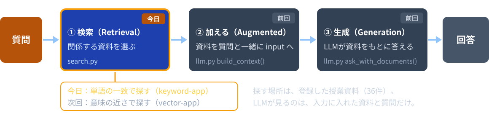
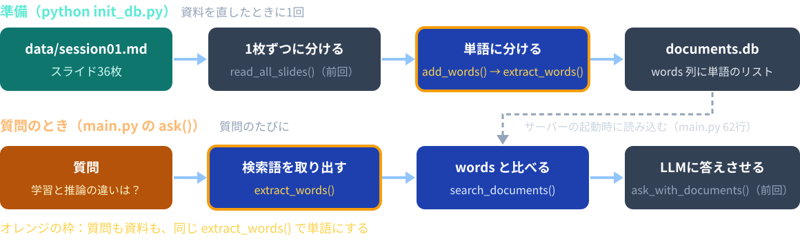
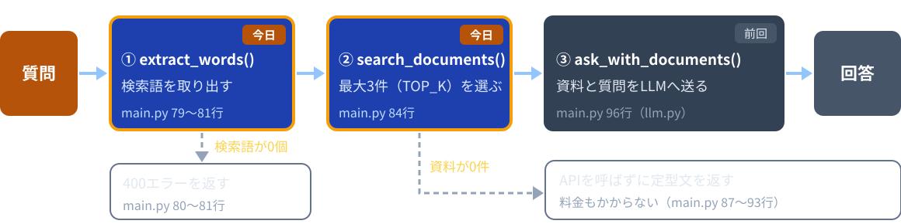
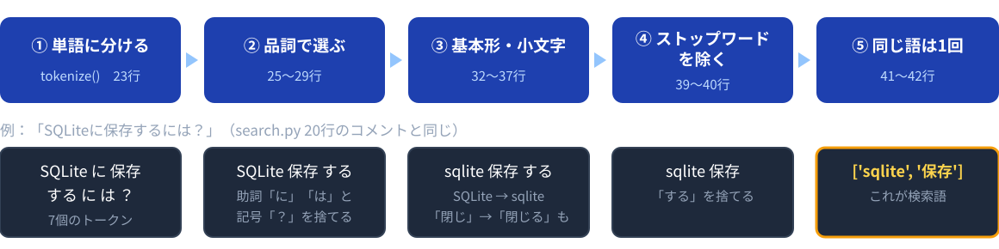
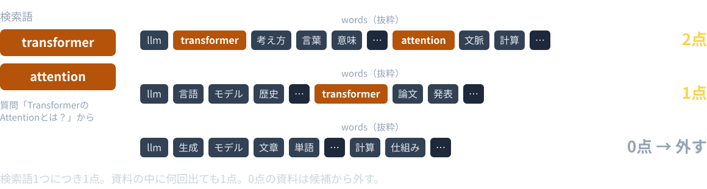
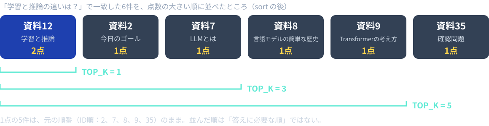
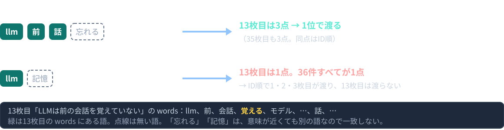

# 第5回：検索してから回答する

キーワード検索で、LLMに渡す資料を選ぶ

---

## 授業の前に：forkを最新にする

配布リポジトリが更新されていてもよいように、毎回最初に自分のforkを最新にします。

```bash
git remote add upstream https://github.com/kappaexpress/llm-app-intro-class-2026   # 初回のみ
git fetch upstream
git merge upstream/main
```

GitHubの自分のforkにある **Sync fork** ボタンでもかまいません。
続けて `source .venv/bin/activate` を実行します。
APIキーは、サーバーを起動するターミナルで `export OPENAI_API_KEY=sk-********` を実行します。

---

## 今日のゴール

1. RAGを「検索して、資料を入力に加えて、生成する」構成として説明し、`ask()` のどこが検索かを指せる
2. 質問がJanomeで検索語になる流れを、画面の「検索語」と結びつけて説明できる
3. 「一致した検索語の数」で資料に点数を付ける処理を手計算でき、`for` と `if` で書ける
4. 点数順の並べ替えと `TOP_K`（最大件数）を説明し、変えたときの違いを観察できる
5. 誤答のとき、検索と生成のどちらを先に調べるかを判断できる
6. キーワード検索が表記の違いに弱いことを、例で示せる

---

## 今日の進め方

| 段階 | すること |
|---|---|
| 1 | `sample-app/keyword-app/` の完成版で、検索語と一致数を観察する |
| 2 | VS Codeで `search.py` を読みながら説明を聞く |
| 3 | `session05/exercise/search.py` の2か所を埋めて動かす |
| 4 | `TOP_K` を変えたり、見つからない質問を送ったりして観察する |
| 5 | コミット・プッシュして、GitHubのURLをTeamsの出席フォームから提出する |

アプリは前回と同じ `keyword-app/` です。穴埋めの答えは `sample-app/keyword-app/search.py` です。
質問するたびにAPI利用料金が発生します（検索で0件のときは呼びません）。
キーは `.env`、Codespaces Secrets、シェルの設定ファイルに保存しません。

---

## RAG：検索してから生成する



**RAG**（Retrieval-Augmented Generation、検索拡張生成）は、質問に関係する情報を検索し、入力に加えて生成する構成です。
インターネット検索に限りません。この教材では、登録した授業資料の中を探します。

---

## 準備のときと、質問のとき



資料を単語に分ける重い処理は、準備のときに1回だけ済ませます。質問のときは、質問だけを単語に分けます。
前回読んだ `init_db.py` のうち、今日新しく読むのは `add_words()`（158〜165行）です。

---

## ask() の3段階



`main.py` の `ask()`（72〜109行）が、この順に呼びます。①②は `search.py`、③は `llm.py` にあります。
`TOP_K = 3` は `main.py` 31行です。

---

## 「学習と推論の違いは？」の場合

| 段階 | 関数 | 結果 |
|---|---|---|
| ① 検索語を取り出す | `extract_words()` | `['学習', '推論', '違い']` |
| ② 資料を探す | `search_documents()` | 点数付きの資料。多い順に最大3件（12、2、7枚目） |
| ③ LLMに答えさせる | `ask_with_documents()` | 3件の資料を根拠にした回答 |

②で選ばれなかった資料は、LLMには届きません。
**検索で何が選ばれたか**が、回答の材料を決めます。

---

## 実習1：検索語と一致数を観察する（12分）

```bash
cd sample-app/keyword-app
python init_db.py
python main.py
```

「ポート」タブから8001番を開き、2つ送ります。

| 質問 | 検索語 | 渡る資料（一致した検索語の数） |
|---|---|---|
| 学習と推論の違いは？ | 学習、推論、違い | 12（2）、2（1）、7（1） |
| TransformerのAttentionとは？ | transformer、attention | 9（2）、8（1） |

- 回答の `[資料ID]` は、渡した資料のどれか。1点の資料は根拠に使われたか
- 終わったら Ctrl+C で止め、`cd ../../session05/exercise` で移動しておく

---

## extract_words()：質問から検索語を取り出す



`search.py` 17〜43行。Janome（ジャノメ）は、日本語の文章を単語に分ける Python のライブラリです。
単語に分けて品詞を付けることを、**形態素解析**と呼びます。

---

## Janomeの出力を見る

`tokenizer.tokenize('学習と推論の違いは？')` の結果です。

| 単語（`surface`） | 品詞（`part_of_speech`） | 使うか |
|---|---|---|
| 学習 | 名詞,サ変接続,\*,\* | 使う |
| と | 助詞,並立助詞,\*,\* | 捨てる（助詞） |
| 推論 | 名詞,サ変接続,\*,\* | 使う |
| の | 助詞,連体化,\*,\* | 捨てる（助詞） |
| 違い | 名詞,ナイ形容詞語幹,\*,\* | 使う |
| は | 助詞,係助詞,\*,\* | 捨てる（助詞） |
| ？ | 記号,一般,\*,\* | 捨てる（記号） |

品詞は1つの文字列です。`split(',')`（25行）で分けると、`parts[0]` が品詞、`parts[1]` が細分類です。

---

## 品詞で選ぶ3つのリスト

<style scoped>table { font-size: 21px; }</style>

| 定数（`search.py`） | 値 | 使い方 |
|---|---|---|
| `USE_PARTS`（8行） | 名詞、動詞、形容詞 | この品詞だけ使う（26〜27行） |
| `SKIP_DETAILS`（11行） | 非自立、代名詞、接尾 | 細分類がこれなら捨てる（28〜29行） |
| `STOP_WORDS`（14行） | する、ある、いる、なる、できる、れる、られる | 捨てる（39〜40行） |

`STOP_WORDS` は、どの文章にも出てくるので、検索の手がかりにならない語です。

| 例 | Janomeの品詞 | 結果 |
|---|---|---|
| 「この授業」の「この」 | 連体詞 | 捨てる（`USE_PARTS` に無い） |
| 「モデルは何？」の「何」 | 名詞,代名詞 | 捨てる（`SKIP_DETAILS`） |
| 「記憶力」の「力」 | 名詞,接尾 | 捨てる（`SKIP_DETAILS`） |

---

## 基本形にそろえる

```python
        # 基本形にそろえる。「閉じて」の「閉じ」→「閉じる」。
        word = token.base_form
        if word == '*':
            # 辞書に無い語は基本形が '*' になるので、文章に書かれた形を使う。
            word = token.surface
        # 'SQLite' と 'sqlite' を同じ語として扱う。
        word = word.lower()

        if word in STOP_WORDS:
            continue
        if word not in words:  # 同じ語は1回だけ入れる
            words.append(word)
    return words
```

`search.py` 31〜43行。「使って」も「使います」も、基本形の「使う」になります。
書き方の違いを少しでも減らし、同じ語として数えるためです。

---

## 検索語の例

| 質問 | 取り出される検索語 |
|---|---|
| 学習と推論の違いは？ | 学習、推論、違い |
| TransformerのAttentionとは？ | transformer、attention |
| SQLiteに保存するには？ | sqlite、保存 |
| この授業で使うモデルは何？ | 授業、使う、モデル |
| ？？？ | （無し） |

検索語が1つも無いと、`main.py` は400のエラー
「質問から検索語を取り出せませんでした。名詞を含めて質問してください。」を返します（80〜81行）。

---

## 資料側の単語：add_words()

```python
def add_words(documents):
    for document in documents:
        document['words'] = extract_words(
            document['title'] + '\n' + document['heading'] + '\n' + document['body'])
```

`init_db.py` 158〜165行。資料の単語も、質問と**同じ** `extract_words()` で作ります。
分け方が違うと、同じ言葉でも一致しなくなるためです。リストはJSONの文字列にして `words` 列に保存します。

題名「第1回：LLMイントロダクション」も含めるので、`llm`、`1`、`イントロダクション` は36件すべてに入っています。

---

## 検索のスコア：一致した検索語の数



点数の大きい順に並べ、上から最大 `TOP_K` 件をLLMに渡します（並べ方は後半）。

---

## 手計算：3つの資料の点数を予想する（2分）

検索語は `学習`、`推論`、`違い` です。`words` の値は実物の抜粋です。

| 資料 | `words` の抜粋 |
|---|---|
| 12枚目「学習と推論」 | 学習、推論、処理、授業、データ、モデル、パラメータ、api |
| 7枚目「LLMとは」 | llm、規模、言語、モデル、大量、文章、学習、入力、予測 |
| 13枚目「LLMは前の会話を覚えていない」 | 前、会話、覚える、モデル、入力、出力、名前、佐藤 |

それぞれ何点になるか、手元にメモしてください。0点の資料はどうなるでしょう。

---

## 手計算の解答

| 資料 | 学習 | 推論 | 違い | 合計 |
|---|---|---|---|---|
| 12枚目 | 1 | 1 | 0 | **2** |
| 7枚目 | 1 | 0 | 0 | **1** |
| 13枚目 | 0 | 0 | 0 | **0** |

13枚目は0点なので、候補から外れます。
「違い」は3つのどれにも無く、36件の中では2枚目「今日のゴール」にだけ入っています。
この点数は、質問の答えが本文にある確率ではありません。

---

## forとifで数える

```python
    results = []
    for document in documents:
        score = 0
        for keyword in keywords:
            if keyword in document['words']:
                score += 1

        if score > 0:
            results.append({
                'id': document['id'],
                ...
                'score': score,
            })
```

`search.py` 52〜68行。外側の `for` が資料を1件ずつ、内側の `for` が検索語を1つずつ見ます。
`in` は、リストにその語があるかを調べます。0点の資料は `results` に入れません。

---

## ループ中の score

12枚目「学習と推論」を処理するときの、`score` の変わり方です。

| タイミング | keyword | `words` に含まれるか | score |
|---|---|---|---|
| 開始（54行） | まだ取り出していない | — | 0 |
| 1回目 | 学習 | 含まれる | 1 |
| 2回目 | 推論 | 含まれる | 2 |
| 3回目 | 違い | 含まれない | 2 |

次の資料に移ると、54行の `score = 0` からやり直します。
前の資料の点数を引き継ぐと、後ろの資料ほど点数が大きくなり、順位が変わってしまいます。

---

## 実習2：点数のループを埋める（15分）

1. `session05/exercise` で `python init_db.py` → `python main.py`
2. 埋める前に「学習と推論の違いは？」を送り、「関係する資料が見つかりませんでした」になることを見る
3. `search.py` 57〜59行の3行のコメントを外す（次のスライド）
4. サーバーを止めて起動し直し、同じ質問を送る

```bash
cd ../../session05/exercise   # sample-app/keyword-app から移る
python init_db.py
python main.py
```

埋める前はエラーになりません。画面の表示で気づく必要があります。
うまく動かないときは「失敗した場所の切り分け」（37枚目）を見ます。

---

## 実習2：埋める場所

```python
    for document in documents:
        score = 0
        # TODO: 資料の単語に含まれる検索語の数を数える。下のコメントを外す。
        # （埋めるまでは score が 0 のままなので、どの資料も見つからない）
        # for keyword in keywords:
        #     if keyword in document['words']:
        #         score += 1

        if score > 0:
```

- `for keyword` からの3行を選び、Ctrl + /（Macは Cmd + /）でコメントを外す
- `for` が `score = 0` と同じ字下げになればよい。TODOの2行はコメントのまま
- 埋めた直後は、資料が**6件・ID順**で渡ります。点数順と件数は、後半の実習3で直します
- 余裕があれば `if score > 0:` の前に `print(document['id'], score)` を入れ、36件の点数を見る（後で消す）

---

## 前半のまとめ

- RAGは、検索して、資料を入力に加えて、生成する。今日は検索の部分を読んでいる
- 質問も資料も、同じ `extract_words()` で単語のリストにする
- 資料の `words` に含まれる検索語の数が、その資料の点数になる
- 0点の資料は候補から外れる

**検索は、文の意味ではなく、単語が一致した数で資料を選んでいます。**

---

# 休憩

**6限は 18:20 から始めます。**

後半は、点数順の並べ替えと `TOP_K`、そして検索がうまくいかない質問です。

---

## 並べ替えて、上位を取り出す

```python
    # スコアの大きい順に並べる。同じスコアなら資料IDの小さい順のまま。
    results.sort(key=get_score, reverse=True)
    return results[:top_k]


def get_score(result):
    """並べ替えで使う。資料のスコアを返す。"""
    return result['score']
```

`search.py` 70〜77行。`results` の1件は辞書なので、そのままでは大小を比べられません。
`key=get_score` で「点数で比べる」と指定し、`reverse=True` で大きい順にします。
`[:top_k]` は先頭から `top_k` 件を取り出す書き方です。`top_k` には `main.py` の `TOP_K = 3` が渡ります。

---

## 同じ点数なら、ID順のまま



`sort()` は、同じ点数なら元の順番を保ちます。元の順番は、`main.py` 43行の `ORDER BY id` で読んだID順です。

---

## TOP_K は最大件数

| 質問 | 一致した資料 | `TOP_K = 3` で渡る資料 |
|---|---|---|
| 学習と推論の違いは？ | 6件 | 12、2、7（3件） |
| TransformerのAttentionとは？ | 2件 | 9、8（2件） |
| 来年度の試験日は何月何日？ | 1件 | 32（1件） |
| 校庭の桜はいつ咲く？ | 0件 | なし |

`TOP_K` は「最大で何件渡すか」です。必ずその件数が渡るわけではありません。
0点の資料は除くので、一致した資料が少なければ、渡る件数も少なくなります。

---

## 0件なら、APIを呼ばない

```python
    found = search_documents(keywords, documents, TOP_K)

    # 3. 見つかった資料を渡して、LLMに回答させる。
    if not found:
        # 資料が無いときは、APIを呼ばずに知らせる（料金もかからない）。
        result = {
            'answer': '関係する資料が見つかりませんでした。言葉を変えて質問してください。',
            'input_tokens': 0,
            'output_tokens': 0,
        }
```

`main.py` 84〜93行。資料が1件も無いときは、LLMに送っても資料に基づく回答は作れません。
APIを呼ばないので料金もかからず、画面には「入力0トークン・出力0トークン」と出ます。

---

## 画面で見るもの

| 画面の表示 | 中身 | `static/app.js` |
|---|---|---|
| 検索語 | `extract_words()` が質問から取り出した単語 | 69行 |
| LLMに渡した資料 | `search_documents()` が返した資料。ID・見出し・本文 | 17〜20行 |
| 一致した検索語の数 | 各資料の `score` | 23行 |
| 完了（入力…トークン） | APIの利用量。0件のときは0 | 71行 |

検索の結果は「検索語」と「LLMに渡した資料」で、生成の結果は「回答」で確かめます。
資料を渡しても、回答が正しいとは限りません（前回の照合）。

---

## 実習3：並べ替えと上位件数を埋める（12分）

実習2を埋めただけの状態で「学習と推論の違いは？」を送ると：

| 埋める前の画面 | 原因 |
|---|---|
| 「LLMに渡した資料」が6件 | `[:top_k]` が無く、全部返している |
| 2、7、8、9、12、35 の順 | `sort()` が無く、ID順のまま |

```python
    # TODO: 並べ替えて、先頭から top_k 件だけ返す。下の2行のコメントを外し、仮の return の行を消す。
    # results.sort(key=get_score, reverse=True)
    # return results[:top_k]
    return results  # 仮。見つかった資料を、並べ替えずに全部返している
```

`search.py` 74〜75行のコメントを外し、76行の仮の `return` を消します。
起動し直して同じ質問を送り、12、2、7 の3件が点数順に並ぶことを確かめます。

---

## 実習4：TOP_K を変えて比較する（12分）

`session05/exercise/main.py` 31行の `TOP_K` を変え、起動し直して「学習と推論の違いは？」を送ります。

| `TOP_K` | 渡る資料 | 見ること |
|---|---|---|
| 1 | 12 | 回答は変わるか |
| 3 | 12、2、7 | 1点の資料は回答に使われたか |
| 5 | 12、2、7、8、9 | 入力トークン数の増え方 |

一度に変える条件は `TOP_K` だけにします。質問も同じものを使います。
`build_context()` が作る資料の文字列は、1件で約200文字、3件で約600文字、5件で約1100文字です。
**終わったら3に戻します。**

---

## 0件と根拠不足の違い

| 検索結果 | 教材の処理 | 確認すること |
|---|---|---|
| 0件 | LLMを呼ばず、固定の文を返す | 利用量が0か |
| 1件以上だが、答えが無い | 資料を渡して生成する | 「資料からは確認できません」と言えるか |
| 必要な根拠がある | 資料を渡して生成する | 根拠に沿って答えているか |

「来年度の試験日は何月何日？」は2行目です。
第1回32枚目に質問文が書いてあるので見つかりますが、試験日は書いてありません。
**資料が見つかったことと、答えが資料にあることは別です。**

---

## 表記が違うと一致しない



キーワード検索は、単語が同じかどうかだけを見ます。意味の近さは判定しません。
「保管」と「保存」のような言い換えも一致しません。この失敗を、次回のベクトル検索と比べます。

---

## 検索と生成の失敗を分ける

| 検索結果 | 回答 | 最初に調べる場所 |
|---|---|---|
| 必要な根拠が渡っていない | 誤答 | 検索語、`STOP_WORDS`、`TOP_K`（検索） |
| 必要な根拠が渡っている | 誤答 | 指示文、渡した本文、モデルの出力（生成） |
| 根拠が渡っていない | 回答を控えた | 言い換えると見つかるか |
| 根拠が渡っている | 正答 | 別の質問でも確かめる |

検索結果を見ずに、指示文だけを変え続けないようにします。
画面の「検索語」と「LLMに渡した資料」が、切り分けの材料です。

---

## 実習5：見つからない質問（15分）

| 質問 | 検索語 | 起こること |
|---|---|---|
| 校庭の桜はいつ咲く？ | 校庭、桜、咲く | 0件。APIを呼ばず固定の文を返す |
| 来年度の試験日は何月何日？ | 来年度、試験、月、何 | 32枚目が見つかるが、試験日は無い |
| LLMが前の話を忘れるのはなぜ？ | llm、前、話、忘れる | 「忘れる」は無いが、「前」「話」で13枚目が1位 |
| LLMの記憶力は？ | llm、記憶 | `llm` で36件が1点。1〜3枚目が渡る |

それぞれ、前の「0件と根拠不足の違い」「検索と生成の失敗を分ける」の表のどの行に当たるかを記録します。
0件のときは、ステータスの「入力0トークン・出力0トークン」を確かめます。

---

## 発展：STOP_WORDS を増やす

「この授業で使うモデルは何？」の検索語は「授業、使う、モデル」です。「使う」は36件中11件に出ます。

1. `search.py` 14行の `STOP_WORDS` の最後に `'使う'` を足す
2. サーバーを止めて `python init_db.py` を実行し、資料側の単語も作り直す
3. `python main.py` で起動し直し、検索語が「授業、モデル」になることを確かめる
4. 渡る資料がどう変わったか（18・21・29枚目 → 12・18・21枚目）を見る

資料の単語も同じ `extract_words()` で作っているので、`search.py` を変えたら `init_db.py` をやり直します。
語を除けば必ず良くなるとは限りません。変える前と後を、同じ質問で比べます。

---

## 失敗した場所の切り分け

| 観察した状態 | まず確認すること |
|---|---|
| `janome` の import で止まる | `source .venv/bin/activate` と依存パッケージ |
| 「documents.db がありません」 | `python init_db.py` を実行したか |
| どの質問も「関係する資料が見つかりませんでした」 | 実習2のループのコメントを外したか。起動し直したか |
| 渡した資料が3件を超える、点数順でない | 実習3の2行と、仮の `return` |
| 「質問から検索語を取り出せませんでした」 | 名詞を含む質問にする |
| 「API呼び出しに失敗しました」 | キー・モデル・利用枠 |
| 資料や `STOP_WORDS` を直しても変わらない | `init_db.py` の再実行と、起動し直し |

相談するときは、質問文・画面の「検索語」・「LLMに渡した資料」を伝えます。キーは共有しません。

---

## 今日のポイント

- 質問の文をそのまま資料の本文と比べてはいない。Janomeで単語に分け、資料の `words` に含まれる検索語の数を数える
- `TOP_K` は最大件数。0点の資料は除くので、一致した資料が少なければ、LLMに渡る件数も少ない
- 検索結果が0件のとき、APIは呼ばれない。固定の文を返し、トークン数は0になる
- 表記が違う語は一致しない。「覚えていない」と書かれた資料は「忘れる」では見つからず、他の語が一致したときだけ出る

---

## 提出物と次回

`session05/exercise/` をコミットし、プッシュします。先に `main.py` の `TOP_K` が3に戻っているか確かめます。

```bash
cd ../..   # リポジトリのルートへ戻る
git add session05/exercise
git commit -m "第5回: キーワード検索"
git push
```

GitHubで `session05/exercise` を開き、そのURLをTeamsの出席フォームから提出します。授業の終わりの時点で未完成でも提出します。
`STOP_WORDS` を変えた人は、そのままでかまいません。`documents.db` とAPIキーは提出物に入りません。
終了時はサーバーを止めて `unset OPENAI_API_KEY`。次回は `vector-app/` で、意味の近さで探します。
