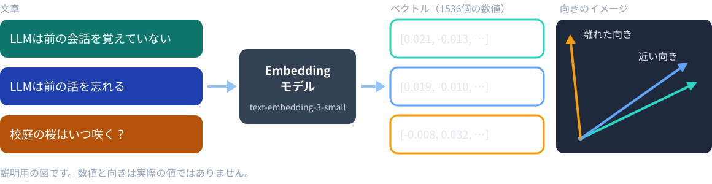
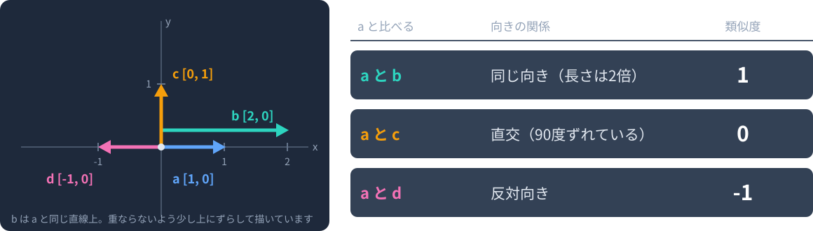
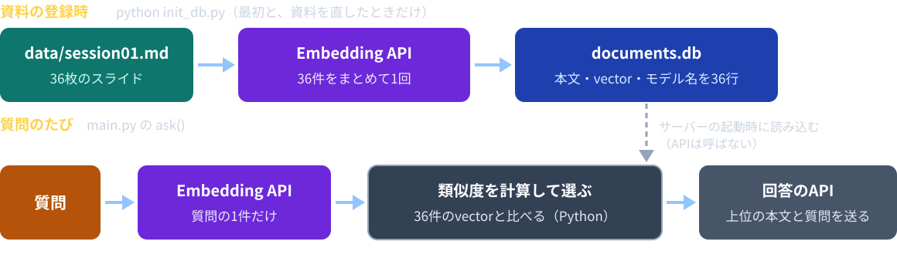
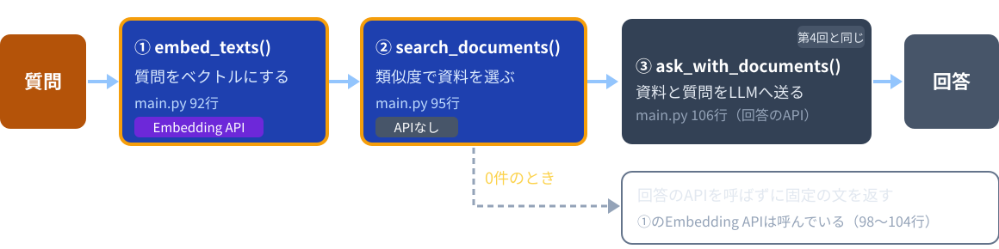
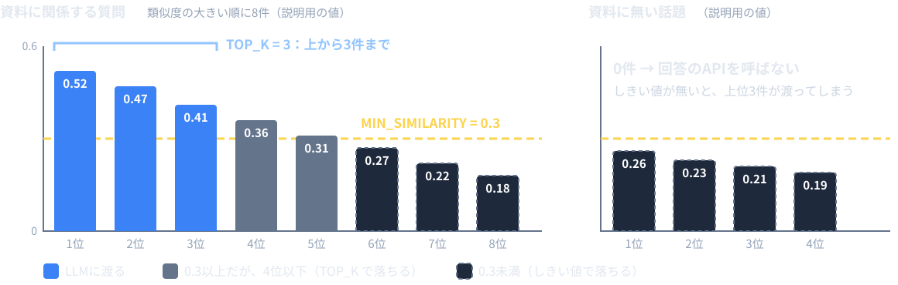

# 第6回：意味で探す検索

Embeddingとコサイン類似度で、言い方が違っても資料を探す

---

## 授業の前に：forkを最新にする

配布リポジトリが更新されていてもよいように、毎回最初に自分のforkを最新にします。

```bash
git remote add upstream https://github.com/kappaexpress/llm-app-intro-class-2026   # 初回のみ
git fetch upstream
git merge upstream/main
```

GitHubの自分のforkにある **Sync fork** ボタンでもかまいません。
続けて `source .venv/bin/activate` を実行します。
APIキーは、使うターミナルで `export OPENAI_API_KEY=sk-********` を実行します。
今日は `python init_db.py` を実行するときにも、キーが必要です。

---

## 今日のゴール

1. 文章をベクトルにし、向きの近さで資料を探す仕組みを、前回のキーワード検索と比べて説明できる
2. コサイン類似度を「内積 ÷ 長さの積」として手計算し、`for` と `if` のコードで書ける
3. 資料と質問をベクトルにするタイミングと、質問1回で呼ぶAPIの回数を言える
4. `MIN_SIMILARITY`（足切り）と `TOP_K`（最大件数）の違いを説明できる
5. 同じ質問を2つの検索に送り、選ばれた資料の違いを記録できる
6. `init_db.py` のやり直しが必要かどうかを判断できる

---

## 今日の進め方

| 段階 | すること |
|---|---|
| 1 | `sample-app/vector-app/` の完成版を動かす（8002番） |
| 2 | VS Codeでコードを読みながら説明を聞く |
| 3 | `session06/exercise/search.py` の2か所を埋めて動かす |
| 4 | `keyword-app`（8001番）と同じ質問で比べる |
| 5 | コミットしてプッシュし、GitHubのURLをTeamsの出席フォームから提出する |

穴埋めの答えは `sample-app/vector-app/search.py` です。写してもよいので、なぜそう書くかを説明できるようにします。
今日は `init_db.py` もEmbedding APIを呼びます（完成版と exercise で1回ずつ）。質問のたびにも料金が発生します。
キーは `.env`、Codespaces Secrets、シェルの設定ファイルに保存しません。

---

## 前回見つからなかった質問

前回のキーワード検索（`keyword-app`）の結果です。

| 質問 | 検索語 | 渡った資料 |
|---|---|---|
| LLMが前の話を忘れるのはなぜ？ | llm、前、話、忘れる | 13（3点）、35、3 |
| LLMの記憶力は？ | llm、記憶 | 1、2、3（36件すべてが同点の1点） |

13枚目「LLMは前の会話を覚えていない」は、「記憶」とも「忘れる」とも一致しません。
「忘れる」の質問で見つかったのは、「前」「話」が一致したからです。

今回は、文章を数値の列（ベクトル）に変え、向きの近さで比べます。
必ず見つかるわけではありません。実習4で、同じ質問を2つの検索に送って比べます。

---

## 文章をベクトルにする



Embeddingモデルは、文章を決まった個数の数値の列にします。
意味が近い文章ほど、近い向きのベクトルになるように作られています。

---

## ベクトルとは

数値を並べたものです。説明用の例：

```python
a = [1.0, 0.0, 1.0]
b = [0.9, 0.1, 1.0]
c = [0.0, 1.0, 0.0]
```

`a` と `b` は近く、`c` は離れています。
実際のEmbeddingは長いリストです。`text-embedding-3-small` は1つの文章を1536個の数値にします。
各数値を「価格」「色」のように直接読み取れるとは限りません。
`llm.py` 24行のコメントの例：`[[0.012, -0.034, ...]]`（文章1つにつき、数値のリストが1つ）

---

## 向きで比べる



実際のEmbeddingではなく、計算用の2次元の例です。
コサイン類似度は、長さではなく向きの関係を比べます。

---

## 生成用と検索用のモデル

| 用途 | モデル | 出力 | `main.py` |
|---|---|---|---|
| 回答を作る | gpt-6-luna | 文章 | 28行 `MODEL` |
| 文章をベクトルにする | text-embedding-3-small | 数値の列 | 31行 `EMBEDDING_MODEL` |

資料と質問には、同じEmbeddingモデルを使います。
別のモデルが作ったベクトルどうしは、そのまま比べられません。
そのため `main.py` は、DBのベクトルを作ったモデル名を起動時に確かめます（解説3で読む）。

---

## 2つのタイミング



資料のベクトルは、`init_db.py` で作ってDBに保存し、使い回します。
サーバーを再起動しても、資料のEmbedding APIは呼びません。質問のたびに呼ぶのは、質問の分だけです。

---

## 実習1：完成版を動かす（12分）

```bash
cd sample-app/vector-app
python init_db.py   # Embedding APIを呼ぶ。利用料金が発生する
python main.py
```

「36個の資料とベクトルを documents.db に保存しました。」と出たら、`main.py` を起動します。
「ポート」タブから **8002番** を開き、次の2つを送ります。

| 質問 | 見ること |
|---|---|
| 学習と推論の違いは？ | 渡された資料と「類似度: 0.xxx」。「検索語」の欄は無い |
| LLMの記憶力は？ | 13枚目が入るか。入ったら類似度をメモ（実習4で使う） |

---

## コサイン類似度

2つのベクトルの向きの近さを、-1〜1の数で表します。

```text
内積   = a[0]×b[0] + a[1]×b[1] + …   （同じ位置どうしを掛けて足す）
長さ   = √(各成分の2乗の合計)
類似度 = 内積 ÷ (aの長さ × bの長さ)
```

| 向きの関係 | 類似度 |
|---|---|
| 同じ向き | 1 |
| 直交 | 0 |
| 反対向き | -1 |

ゼロベクトル（`[0, 0]`）は向きが無いので、教材では0として扱います。

---

## 同じ向きの計算例

a = [1, 0]、b = [2, 0] の場合：

| 計算 | 結果 |
|---|---|
| 内積 | 1×2 ＋ 0×0 = 2 |
| aの長さ | √(1² ＋ 0²) = 1 |
| bの長さ | √(2² ＋ 0²) = 2 |
| コサイン類似度 | 2 ÷ (1×2) = 1 |

長さが2倍でも、同じ向きなら類似度は1です。

---

## 向きが異なる計算例

a = [1, 0] を基準にします。

| 比較相手 | 内積 | 長さの積 | 類似度 |
|---|---|---|---|
| [0, 1] | 0 | 1 | 0 |
| [-1, 0] | -1 | 1 | -1 |
| [0, 0] | 0 | 0 | 教材では0 |

ゼロベクトルは長さが0なので、そのままでは割り算できません。
`cosine_similarity()` は、どちらかの長さが0なら `0.0` を返します。

---

## cosine_similarity()：forで内積と長さを求める

```python
    dot = 0.0       # 内積: 同じ位置の数どうしを掛けて、全部足したもの
    a_length = 0.0  # a の長さの2乗
    b_length = 0.0  # b の長さの2乗
    for i in range(len(a)):
        dot += a[i] * b[i]
        a_length += a[i] * a[i]
        b_length += b[i] * b[i]
    if a_length == 0 or b_length == 0:
        return 0.0  # 長さ0のベクトルは向きが無いので、0とする
    return dot / (math.sqrt(a_length) * math.sqrt(b_length))
```

`search.py` 11〜20行。`i` はリストの位置で、同じ位置の成分どうしを掛けます。
`a_length` はループの中では「長さの2乗」です。平方根（`math.sqrt()`）は割り算の直前です。

---

## 予想してみよう：ループの途中の値（2分）

a = [1, 2]、b = [2, 1] のとき、表の「?」はいくつになるでしょう。

| 段階 | dot | a_length | b_length |
|---|---|---|---|
| 初期値 | 0 | 0 | 0 |
| i = 0 の後 | ? | ? | ? |
| i = 1 の後 | ? | ? | ? |

最後に、類似度 = dot ÷ (√a_length × √b_length) も計算してみます。
紙でも、頭の中でもかまいません。

---

## 答え：ループの途中の値

a = [1, 2]、b = [2, 1] の場合：

| 段階 | dot | a_length | b_length |
|---|---|---|---|
| 初期値 | 0 | 0 | 0 |
| i = 0 の後 | 0 ＋ 1×2 = 2 | 0 ＋ 1×1 = 1 | 0 ＋ 2×2 = 4 |
| i = 1 の後 | 2 ＋ 2×1 = 4 | 1 ＋ 2×2 = 5 | 4 ＋ 1×1 = 5 |

類似度は 4 ÷ (√5 × √5) = 4 ÷ 5 = **0.8** です。
`a_length` と `b_length` は、ループの中では長さの2乗のまま足していきます。

---

## 実習2：類似度の計算を埋める（15分）

完成版のサーバーは動かしたままでかまいません。
**別のターミナル**で、埋める前の動きを見ます。APIキーは不要です。

```bash
cd session06/exercise
python
```

```python
from search import cosine_similarity
cosine_similarity([1, 0], [1, 0])   # 埋める前は 0.0
```

同じ向きなのに `0.0` です。`a_length` が0のままだからです。
`exit()` で抜け、`search.py` 16〜19行のコメントを外します（次のスライド）。

---

## 実習2：埋める場所

```python
    b_length = 0.0  # b の長さの2乗
    # TODO: 同じ位置の数どうしを掛けて足していく。下のコメントを外す。
    # （埋めるまでは長さが0のままなので、類似度はいつも0になる）
    # for i in range(len(a)):
    #     dot += a[i] * b[i]
    #     a_length += a[i] * a[i]
    #     b_length += b[i] * b[i]
    if a_length == 0 or b_length == 0:
```

- `session06/exercise/search.py` 13〜20行。`for` からの4行（16〜19行）を選び、Ctrl + /（Macは Cmd + /）でコメントを外す
- `for` が `b_length = 0.0` と同じ字下げになり、中の3行がさらに1段下がればよい
- 14〜15行の `TODO` の説明は、コメントのままでかまわない

---

## 実習2：確かめる値

もう一度 `python` を起動し、`from search import cosine_similarity` の後で試します。

| 入力 | 期待する結果 |
|---|---|
| `cosine_similarity([1, 0], [1, 0])` | 1.0 |
| `cosine_similarity([1, 0], [2, 0])` | 1.0 |
| `cosine_similarity([1, 0], [0, 1])` | 0.0 |
| `cosine_similarity([1, 2], [2, 1])` | 約0.8（0.7999999999999998 と出る） |
| `cosine_similarity([0, 0], [1, 0])` | 0.0（教材の取り決め） |

末尾の小さなずれは、小数の計算で起きる丸めの差です。手計算の表と一致すれば完成です。
終わったら `exit()` で抜けます。

---

## vector-app のファイル

| ファイル | 役割 | keyword-app との違い |
|---|---|---|
| `init_db.py` | スライドを資料に分け、DBに保存する | 単語の代わりにベクトルを保存。Embedding APIを呼ぶ |
| `main.py` | 起動時にDBを読む。`ask()` が質問を処理する | 質問もベクトルにする。モデル名を確かめる |
| `llm.py` | APIを呼ぶ | `embed_texts()` が増えた。`build_context()`・`INSTRUCTIONS` は同じ |
| `search.py` | 資料を探す | 一致した語の数の代わりに、類似度で並べる |
| `static/` | 画面 | 「検索語」の欄が無く、資料ごとに「類似度」を出す |

単語の代わりにベクトルを保存し、一致数の代わりに類似度で並べる。違いはそれだけです。

---

## embed_texts()：文章をベクトルにする

```python
def embed_texts(texts, model):
    client = make_client()
    # 複数の文章を1回のAPI呼び出しでまとめてベクトルにする。
    response = client.embeddings.create(model=model, input=texts)
    vectors = []
    for item in response.data:  # 送った文章と同じ順番で返ってくる
        vectors.append(item.embedding)
    return vectors
```

`llm.py` 21〜33行（説明の文字列は省略）。第2回と同じクライアントで、別のAPIを呼びます。
文章のリストを渡すと、1回の呼び出しで、送った順にベクトルのリストが返ります。
文章を外部のAPIへ送るので、この呼び出しでも利用料金が発生します。

---

## add_vectors()：資料をまとめてベクトルにする

```python
def add_vectors(documents, embedding_model):
    """全部の資料をEmbedding APIでベクトルにし、各資料の 'vector' に入れる。"""
    texts = []
    for document in documents:
        texts.append(document['title'] + '\n' + document['heading'] + '\n' + document['body'])
    # 1回のAPI呼び出しで、全部の資料をまとめてベクトルにする。
    vectors = embed_texts(texts, embedding_model)
    for i in range(len(documents)):
        documents[i]['vector'] = vectors[i]  # 資料と同じ順番でベクトルが返ってくる
```

`init_db.py` 162〜170行。題名・見出し・本文をつないだ文章を、資料1件につき1つ作ります。
36件をリストにして、`embed_texts()` に1回で渡します。モデルは51行の `EMBEDDING_MODEL`（`main.py` と同じ値）。

---

## DBに保存するもの

`init_db()` は `documents` テーブルを作り直し、1行に1資料を保存します。

| 列 | 保存する理由 |
|---|---|
| `body`（と `title`・`heading`） | LLMに渡すのは元の文章。ベクトルだけでは回答は作れない |
| `vector` | 質問のたびに比べる。`json.dumps()` でJSONの文字列にする（197行） |
| `embedding_model` | 質問と同じモデルで作ったか確かめる（198行） |
| `source`・`slide` | 原本の何枚目かを確かめる |

SQLiteにはリストの型が無いので、ベクトルは文字列にして保存します。

---

## load_documents()：起動時にDBを読む

```python
def load_documents(database, embedding_model):
    if not database.exists():
        raise SystemExit(f'{database.name} がありません。先に python init_db.py を実行してください。')
    ...
    for row in rows:
        # 別のモデルで作ったベクトルとは比べられないので、作り直してもらう。
        if row[7] != embedding_model:
            raise SystemExit(f'DBのベクトルは {row[7]} で作られています。'
                             f'python init_db.py を実行して、{embedding_model} で作り直してください。')
```

`main.py` 43〜70行の抜粋。DBの `embedding_model` が `EMBEDDING_MODEL` と違えば、起動時に止まります。
`vector` の列は `json.loads(row[6])`（68行）で、JSONの文字列から数値のリストに戻します。

---

## ask() の3段階



| 定数 | 値 | 意味 |
|---|---|---|
| `TOP_K` | 3（34行） | LLMに渡す資料の最大件数 |
| `MIN_SIMILARITY` | 0.3（38行） | これより類似度が小さい資料は渡さない |

質問1つにつき、Embedding APIを1回と、資料が見つかれば回答のAPIを1回呼びます。

---

## 前半のまとめ

- 文章は、Embeddingモデルで数値の列（ベクトル）になる
- 類似度は向きの近さ。「内積 ÷ 長さの積」を `for` で計算する
- 資料は `init_db.py` で1回ベクトルにし、モデル名と一緒にDBに保存する
- 質問は質問のたびにベクトルにし、DBの36件のベクトルと比べる

**資料は登録時に1回、質問は毎回ベクトルにし、向きで比べます。**

---

# 休憩

**6限は 18:20 から始めます。**

後半は、近い資料の選び方（しきい値）と、キーワード検索との比較です。

---

## search_documents()：近い資料を選ぶ

```python
def search_documents(question_vector, documents, top_k, min_similarity):
    results = []
    for document in documents:
        score = cosine_similarity(question_vector, document['vector'])
        if score >= min_similarity:
            results.append({
                ...
                'score': score,
            })
    # 類似度の大きい順に並べる。
    results.sort(key=get_score, reverse=True)
    return results[:top_k]
```

`search.py` 23〜45行の抜粋。全資料との類似度を計算し、しきい値以上だけ残し、大きい順に `top_k` 件までです。
ベクトルそのものは返しません。画面に出すのは `score` です。並べ替えと `[:top_k]` は前回と同じ形です。

---

## 類似度の読み方

画面の「類似度」は、`score` を小数第3位まで表示したものです（`static/app.js` 23行）。

- 1に近いほど、質問と資料の向きが近い
- 類似度は、回答が正しい確率ではない
- キーワード検索の点数（一致した語の数）と同じ尺度ではない
- 類似度が高くても、質問の答えが本文に無いことがある

`MIN_SIMILARITY` の0.3は目安です。画面に出る類似度を見て調整します（実習5）。
回答に付いた資料IDと本文を見比べて、根拠を確かめるのは前回までと同じです。

---

## しきい値と TOP_K の違い



`TOP_K` は「多くても何件」、`MIN_SIMILARITY` は「これ未満は渡さない」です。
しきい値が無いと、資料に無い話題でも、いつも上位3件が渡って回答が作られます。

---

## 実習3：しきい値を埋める（15分）

1. 完成版のサーバー（8002番）を Ctrl+C で止める（exercise も同じ8002番を使う）
2. exercise 側にも `documents.db` を作り、起動する

```bash
cd ../../session06/exercise   # sample-app/vector-app から移る
python init_db.py             # Embedding APIを呼ぶ（料金が発生）
python main.py
```

3. 仮の `if` のまま「校庭の桜はいつ咲く？」を送り、渡った資料と類似度をメモする
4. `search.py` 34〜36行を埋め（次のスライド）、起動し直して同じ質問を送る

0件なら「関係する資料が見つかりませんでした。」と出て、回答のAPIは呼ばれません。

---

## 実習3：埋める場所

<style scoped>pre { font-size: 18px; }</style>

```python
    for document in documents:
        score = cosine_similarity(question_vector, document['vector'])
        # TODO: 類似度が min_similarity 以上の資料だけを残す。下のコメントを外し、仮の if の行を消す。
        # if score >= min_similarity:
        if score > 0:  # 仮。しきい値を使っていないので、関係の薄い資料も残る
            results.append({
```

- `session06/exercise/search.py` 32〜37行。35行のコメントを外し、36行の仮の `if` を消す
- `if` が `score = …` と同じ字下げになればよい
- `min_similarity` には、`main.py` の `MIN_SIMILARITY`（0.3）が渡る
- 仮の `if score > 0:` は類似度が0より大きければ全部残すので、関係の薄い資料も上位3件に入る

---

## 実習4：キーワード検索と比べる（15分）

実習2で使ったターミナルで、`keyword-app`（8001番）も動かします。8002番の exercise は動かしたままです。

```bash
export OPENAI_API_KEY=sk-********   # このターミナルでまだなら
source .venv/bin/activate            # このターミナルでまだなら
cd ../../sample-app/keyword-app      # session06/exercise から移る
python init_db.py                    # documents.db が無いときだけ。キー不要
python main.py
```

「ポート」タブから8001番と8002番の両方を開き、同じ3つの質問を両方に送ります（次のスライド）。
新しいターミナルを開いた人は、`cd sample-app/keyword-app` です。

---

## 実習4：比較の記録

<style scoped>table { display: table; width: 100%; } th:first-child { width: 30%; } th:nth-child(2) { width: 36%; }</style>

| 質問 | キーワード検索（8001） | ベクトル検索（8002） |
|---|---|---|
| 学習と推論の違いは？ | 12（2点）、2、7（1点） | |
| LLMの記憶力は？ | 1、2、3（36件が同点）。13は渡らない | |
| 来年度の試験日は何月何日？ | 32（4点）のみ | |

キーワード検索の列は前回の結果です。8001番でも送って、同じになるか確かめます。
ベクトル検索の列には、渡った資料の番号と類似度を書きます。

- 13枚目「LLMは前の会話を覚えていない」が、どちらで選ばれたか
- 32枚目が見つかっても、回答が試験日を断定しないか
- 点数と類似度は尺度が違うので、数値の大小で優劣を決めない

---

## 比較の見方

| | キーワード検索 | ベクトル検索 |
|---|---|---|
| 比べるもの | 同じ単語があるか | 文章全体の向き |
| 言い換え（記憶・忘れる・覚えていない） | 一致しない | 近い向きになることがある |
| 画面の数値 | 一致した語の数（0以上の整数） | 類似度（-1〜1の小数） |
| 0件になるとき | 一致する語が1つも無い | しきい値以上の資料が無い |
| 呼ぶAPI（質問1回） | 回答のAPIだけ | Embedding API ＋ 回答のAPI |

どちらがいつも優れている、とは言えません。
質問ごとに、選ばれた資料と、回答が本文に沿っているかで比べます。

---

## init_db.py をやり直すとき

| 変えたもの | `init_db.py` | 理由 |
|---|---|---|
| `data/` の資料 | 必要 | 資料の本文とベクトルを作り直す |
| `EMBEDDING_MODEL` | 必要 | 別のモデルのベクトルとは比べられない。`main.py` が止まる |
| `MIN_SIMILARITY`・`TOP_K` | 不要 | 検索のときに使う値。再起動だけでよい |
| `search.py` の穴埋め | 不要 | 計算の仕方だけが変わる。ベクトルは同じ |

`init_db.py` は実行するたびに `documents` テーブルを作り直し、Embedding APIを呼びます。
`documents.db` はGitには入りません。

---

## 費用と規模

| 場面 | 呼ぶAPI |
|---|---|
| `init_db.py` の実行 | Embedding API 1回（36件の資料をまとめて） |
| 質問1回 | Embedding API 1回（質問）＋ 回答のAPI 1回 |
| 資料が0件の質問 | Embedding API 1回のみ |

この教材は36件の資料を、Pythonの `for` で全件比べています。
資料が数万件になると、全件比較では時間がかかります。大規模な検索の仕組みは発展課題です。
まずは、検索の精度と、資料の整え方を身につけます。

---

## 実習5：しきい値を変えてみる（10分）

`session06/exercise/main.py` 38行の `MIN_SIMILARITY` を変え、サーバーを起動し直して、実習4と同じ3問を8002番に送ります。

| 値 | 予想 |
|---|---|
| 0.5 | 渡る資料が減る。0件になる質問が増える |
| 0.3 | 元の値 |
| 0.2 | 関係の薄い資料まで渡ることがある |

ベクトルは変わらないので、`init_db.py` のやり直しは不要です（起動し直すだけ）。
渡る件数と類似度を見比べます。**終わったら 0.3 に戻します。**

---

## 失敗した場所の切り分け

| 観察した状態 | まず確認すること |
|---|---|
| 「documents.db がありません」 | そのフォルダで `python init_db.py` を実行したか（完成版と exercise は別） |
| 「DBのベクトルは … で作られています」 | `EMBEDDING_MODEL` を変えた。`init_db.py` をやり直す |
| 「環境変数 OPENAI_API_KEY を設定して…」 | 同じターミナルで `export` したか。今回は `init_db.py` でも必要 |
| どの質問でも「関係する資料が見つかりません」 | 実習2の `for` のコメントを外したか（類似度がいつも0） |
| 関係の薄い資料が3件渡される | 実習3の仮の `if` を消したか。起動し直したか |
| 8002番で起動できない | 完成版のサーバーを止めたか |
| 「API呼び出しに失敗しました」 | キー・モデル・利用枠 |

相談するときは、操作の手順・画面のステータス・類似度の値を伝えます。キーは共有しません。

---

## 今日のポイント

- 資料と質問には、同じEmbeddingモデルを使う。違うと比べられないので `main.py` が起動時に止まり、`init_db.py` で作り直す
- 類似度0.8は、正答率80%ではない。向きの近さであり、回答の正しさは本文で確かめる
- 資料のベクトルはDBに保存したものを読む。サーバーの再起動ではAPIは呼ばれず、質問のたびに質問の分だけ呼ぶ
- `MIN_SIMILARITY` を変えても、ベクトルは変わらない。`init_db.py` のやり直しは不要で、`main.py` の再起動だけでよい

---

## 提出物と次回

`main.py` の `MIN_SIMILARITY` が 0.3 に戻っていることを確かめてから、`session06/exercise/` をコミットし、プッシュします。

```bash
cd ../..   # リポジトリのルートへ戻る
git add session06/exercise
git commit -m "第6回: ベクトル検索"
git push
```

GitHubで `session06/exercise` を開き、そのURLをTeamsの出席フォームから提出します。授業の終わりの時点で未完成でも提出します。
`documents.db` はコミットされません。APIキーも提出しません。終了時は両方のサーバーを止め、両方のターミナルで `unset OPENAI_API_KEY`。
次回は `progress-app/`。LLMが関数を選び、Pythonが実行します（Function Calling）。
