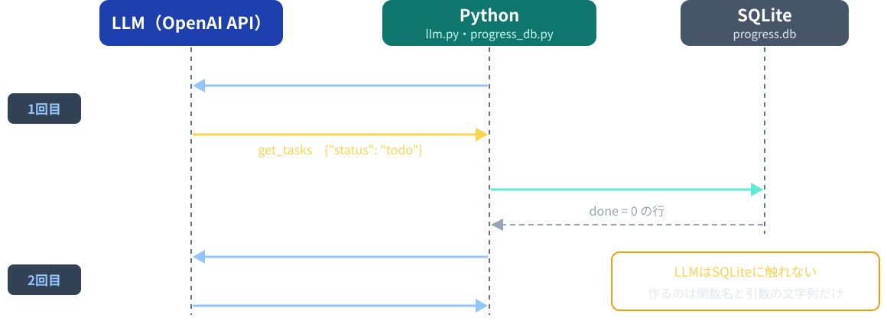
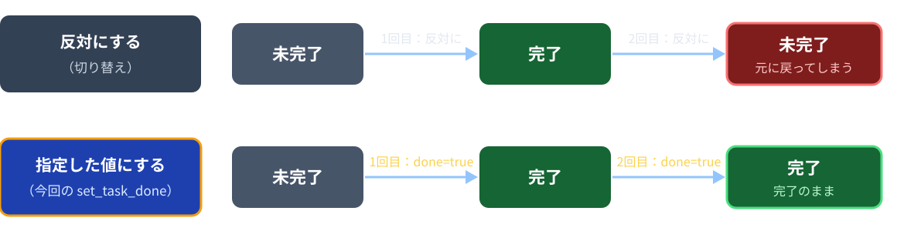
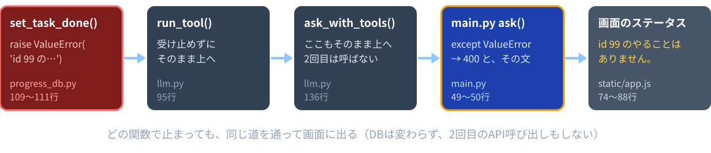
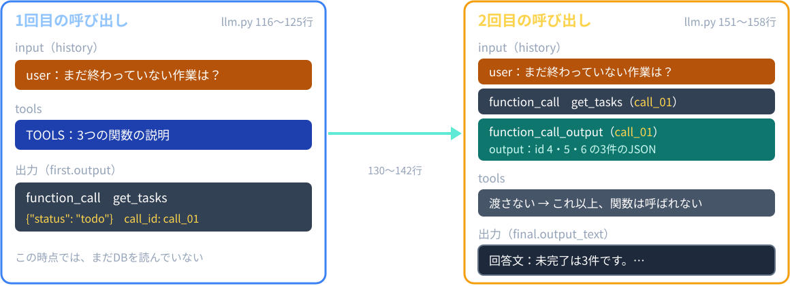
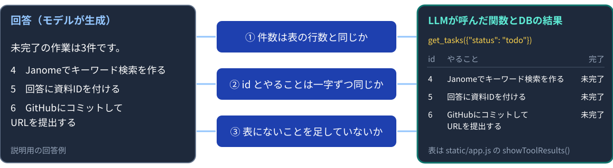

# 第7回：DB・APIを使うLLM

Function Callingで、決められた関数を呼ぶ

---

## 授業の前に：forkを最新にする

配布リポジトリが更新されていてもよいように、毎回最初に自分のforkを最新にします。

```bash
git remote add upstream https://github.com/kappaexpress/llm-app-intro-class-2026   # 初回のみ
git fetch upstream
git merge upstream/main
```

GitHubの自分のforkにある **Sync fork** ボタンでもかまいません。
続けて `source .venv/bin/activate` を実行します。
APIキーは、サーバーを起動するターミナルで `export OPENAI_API_KEY=sk-********` を実行します。

---

## 今日のゴール

1. Function Callingの5段階を、`ask_with_tools()` の行に対応づけて追いかけられる
2. LLMが作るのは関数名と引数だけで、SQLを書くのは `progress_db.py` だけだと説明できる
3. `TOOLS` の `description` と `parameters` が何を決めているかを言える
4. 実行前の検証がどこにあり、どんな引数で止まるかを例で示せる
5. 画面の関数名・引数・表と、最終回答を照合できる
6. 「権限をコードで狭める」設計を挙げられる

---

## 今日の進め方

| 段階 | すること |
|---|---|
| 1 | `sample-app/progress-app/` の完成版を動かし、関数の選ばれ方を観察する |
| 2 | VS Codeで `llm.py` と `progress_db.py` を読む |
| 3 | `session07/exercise/` の2か所（`progress_db.py`、`llm.py`）を埋める |
| 4 | 埋めたアプリに質問し、関数・引数・表・回答を照合する |
| 5 | コミット・プッシュし、URLをTeamsの出席フォームから提出する |

穴埋めの答えは `sample-app/progress-app/` です。写してもよいので、なぜそう書くかを説明できるようにします。
進捗のデータは架空です。関数を呼ぶ質問では、APIを2回呼ぶので料金も2回分かかります。

---

## 文書検索と、更新されるデータ

| 質問 | 参照先 | 回 |
|---|---|---|
| ハルシネーションとは？ | 資料（スライド）を探す | 第5・6回 |
| まだ終わっていない作業は？ | 進捗DBの `done` 列を条件で読む | 今回 |
| id 4 のやることを完了にして | 進捗DBを書き換える | 今回 |

資料は、書かれた内容を探すものでした。
進捗のように更新される状態は、DBを条件で読み、必要なら書き換えます。
今回のデータは、Webアプリ制作の架空の「やること」です。

---

## Function Callingの5段階



LLMが作るのは、関数名と引数の文字列だけです。実行するのはPythonです（`llm.py` 3〜6行）。

---

## 1問を追うための役割分担

質問：「まだ終わっていない作業は？」

| 担当 | この例で行うこと |
|---|---|
| LLM・1回目 | `get_tasks` を `status` = `todo` で呼びたい、と返す |
| Python | 関数名と引数を確かめ、決まったSQLを実行する |
| SQLite | `done = 0` の行を返す |
| LLM・2回目 | 返った行をもとに、回答文を書く |

処理を追うための説明例です。モデルの実際の出力は、実行して確かめます。

---

## 進捗DBの tasks テーブル

`progress_db.py` の `FIRST_TASKS`（11〜18行）。起動時にこの6件を入れます。

| id | task | done |
|---|---|---|
| 1 | 画面のHTMLとCSSを作る | 1 |
| 2 | FastAPIで質問を受け取るAPIを作る | 1 |
| 3 | SQLiteに資料を保存する | 1 |
| 4 | Janomeでキーワード検索を作る | 0 |
| 5 | 回答に資料IDを付ける | 0 |
| 6 | GitHubにコミットしてURLを提出する | 0 |

SQLiteには真偽値の型が無いので、`done` は1（完了）と0（未完了）で保存します。

---

## init_db() と INSERT OR IGNORE

```python
cursor.execute('CREATE TABLE IF NOT EXISTS tasks (id INTEGER PRIMARY KEY, task TEXT, done INTEGER)')
cursor.executemany('INSERT OR IGNORE INTO tasks (id, task, done) VALUES (?, ?, ?)', FIRST_TASKS)
```

`progress_db.py` 25・28行。`main.py` 31行が、起動のたびに呼びます。
`INSERT OR IGNORE` は、同じidの行がすでにあれば何もしません。

| したいこと | 操作 |
|---|---|
| 追加・変更を残したまま再起動 | そのまま `python main.py` |
| 最初の6件に戻す | サーバーを止め、`progress.db` を削除してから起動 |

`progress.db` は `sample-app/progress-app/` と `session07/exercise/` に別々にできます。

---

## 実習1：関数の選び方を観察する（15分）

```bash
cd sample-app/progress-app
python main.py
```

「ポート」タブから8003番を開き、次の4つを順に送ります。

| 質問 | 観察すること |
|---|---|
| まだ終わっていない作業は？ | `get_tasks`、`status` は `todo`、4・5・6の3件 |
| 「READMEを書く」を追加して | `add_task`、id 7 が未完了で増える |
| id 4 のやることを完了にして | `set_task_done`、`task_id` 4・`done` true |
| FastAPIとは？ | 「関数は呼ばれませんでした。」と出るか |

最後にもう一度「まだ終わっていない作業は？」。id 4 が消えて id 7 が入るかを見ます。

---

## 実習1（続き）：画面の読み方とメモ

回答の下の「LLMが呼んだ関数とDBの結果」には、2つが出ます。

- 1行目：`get_tasks({"status": "todo"})` のような、関数名と引数（LLMが返した文字列のまま）
- その下：id・やること・完了の表（Pythonが実行して得た行）

関数を呼ばなかったときは「関数は呼ばれませんでした。」と出ます。
1問ごとに、手元に次の5つをメモします（解説5と実習4で使います）。

| 質問 | 関数名 | 引数 | 表の行（id） | 回答の件数・id |
|---|---|---|---|---|
| まだ終わっていない作業は？ | | | | |

回答の文と表で、件数とidが一致しているかも見ておきます。

---

## LLMが呼べる3つの関数

| 関数 | 引数 | DB | すること |
|---|---|---|---|
| `get_tasks` | `status`（`all`・`todo`・`done`） | 読む | 進捗を調べる |
| `add_task` | `task`（100文字以内） | 書く | やることを未完了で追加する |
| `set_task_done` | `task_id`（整数）、`done`（`true`・`false`） | 書く | 完了フラグを指定した値にする |

削除する関数は用意していません。
1つの質問で呼べる関数は1回だけです。

---

## 「反対にする」ではなく「指定した値にする」



同じ呼び出しが2回起きても結果が変わらないように、`done` の値を引数で指定させます。
idは利用者が示したものだけを使い、LLMに推測させません（`llm.py` 44行・64行）。

---

## TOOLS：関数の説明を渡す

```python
TOOLS = [
    {
        'type': 'function',
        'name': 'get_tasks',
        'description': 'Webアプリ制作の進捗（id・やること・完了フラグ）を調べる。'
                       'status は all（全件）・todo（未完了）・done（完了）。',
        'parameters': {...},
        'strict': True,
    },
```

`llm.py` 14〜56行（`parameters` の中身は次のスライド）。
`description` は、LLMが「どの関数をいつ使うか」を判断する材料です。
`add_task` の説明（31行）には「利用者が追加を頼んだときだけ使う」と書いてあります。

---

## parameters：引数の形

```python
        'parameters': {
            'type': 'object',
            'properties': {'status': {'type': 'string', 'enum': ['all', 'todo', 'done']}},
            'required': ['status'],
            'additionalProperties': False,
        },
        'strict': True,
```

| 指定 | 意味 |
|---|---|
| `enum` | 値は、この選択肢のどれか |
| `required` | 必ず入れる引数 |
| `additionalProperties: False` | それ以外の引数は入れない |
| `strict: True` | この形に合う引数だけを生成させる |

---

## 自然文と引数の対応

| 質問の例 | LLMが呼ぶはずの関数と引数 |
|---|---|
| まだ終わっていない作業は？ | `get_tasks({"status":"todo"})` |
| 終わった作業は？ | `get_tasks({"status":"done"})` |
| 「READMEを書く」を追加して | `add_task({"task":"READMEを書く"})` |
| id 4 のやることを完了にして | `set_task_done({"task_id":4,"done":true})` |
| FastAPIとは？ | 関数を呼ばずに答える場合がある |

日本語の質問を、関数が受け取れる引数に対応させるのはLLMです。右の列は期待です。
準備で試したとき、「4番を完了にして」では、このモデルは `get_tasks` で確認から入り、更新しないことが多くありました。

---

## INSTRUCTIONS：LLMへの指示

```python
INSTRUCTIONS = (
    'Webアプリ制作の進捗は、必ず関数の結果だけを根拠にしてください。'
    '結果にないことは推測しないでください。'
    '進捗の追加や変更は、利用者がはっきり頼んだときだけ行ってください。'
    '複数の関数を呼ぶ必要がある場合は、1つだけ呼んでください。2つ目は呼ばなくてよいです。'
    '完了フラグを変えるときは、利用者が示したidを使い、idを推測しないでください。'
    '日本語で簡潔に回答してください。'
)
```

`llm.py` 59〜66行。指示は「お願い」です。守られる保証はないので、コード側でも制限します。

---

## get_tasks()：決まったSQLから選ぶ

```python
    # 実行するSQLは、この3つの決まった文だけ。LLMが作った文字列をSQLに入れない。
    if status == 'all':
        sql = 'SELECT id, task, done FROM tasks ORDER BY id'
    elif status == 'todo':
        sql = 'SELECT id, task, done FROM tasks WHERE done = 0 ORDER BY id'
    elif status == 'done':
        sql = 'SELECT id, task, done FROM tasks WHERE done = 1 ORDER BY id'
    else:
        raise ValueError('status は all・todo・done のどれかにしてください。')
```

`progress_db.py` 39〜47行。`status` の値で、3つの文のどれかを選ぶだけです。
LLMが作った文字列を、SQLの中につなげることはしません。

---

## 1と0、True と False、true と false

| 置き場所 | 完了 | 未完了 | どこで変わるか |
|---|---|---|---|
| SQLiteの `done` 列 | `1` | `0` | 保存するとき（`progress_db.py` 105行） |
| Pythonの辞書 | `True` | `False` | 読み出すとき（58行 `row[2] == 1`） |
| JSON（LLMと画面へ） | `true` | `false` | `json.dumps()`、FastAPIが返すとき |
| 画面の表 | 完了 | 未完了 | `static/app.js` 39行 |

`get_tasks()` は、1行を `{'id': 4, 'task': '…', 'done': False}` の辞書にして、リストで返します（55〜59行）。

---

## add_task()：保存する前に確かめる

```python
    if not isinstance(task, str):
        raise ValueError('やることは文字列で指定してください。')
    task = task.strip()
    if task == '' or len(task) > MAX_TASK_LENGTH:
        raise ValueError(f'やることは1〜{MAX_TASK_LENGTH}文字にしてください。')
    ...
    cursor.execute('INSERT INTO tasks (task, done) VALUES (?, 0)', (task,))
    new_id = cursor.lastrowid  # 今追加した行のid
```

`progress_db.py` 73〜84行。文字列か、空でないか、100文字以内か（63行）を先に確かめます。
値は `?` の場所に別に渡します。idを書かないので、SQLiteが次の番号を付けます。

---

## set_task_done()：型とidを確かめる

```python
    if isinstance(task_id, bool) or not isinstance(task_id, int):
        raise ValueError('task_id は整数で指定してください。')
    if not isinstance(done, bool):
        raise ValueError('done は true か false で指定してください。')
    ...
    cursor.execute('UPDATE tasks SET done = ? WHERE id = ?', (done_value, task_id))
    changed = cursor.rowcount  # 変更した行の数。そのidが無ければ0になる
```

`progress_db.py` 97〜111行。Pythonでは `True` / `False` も整数の仲間なので、先に除きます。
変更した行が0なら「id 99 のやることはありません。」で止まります。

---

## ValueError が画面に出るまで



`run_tool()` の検証で止まったときも、同じ道を通ります。
画面のステータスに出る文で、どこで止まったかが分かります。

---

## 実習2：get_tasks() のSQLを埋める（15分）

1. `session07/exercise/progress_db.py` 40〜49行の `TODO` を探す
2. `if status == 'all':` から `raise` までの8行のコメントを外す
3. 仮の `raise ValueError('TODO: …')`（49行）を消して保存する
4. 別のターミナルで `cd session07/exercise` → `python` を起動して確かめる（APIキー不要）

```python
from progress_db import init_db, get_tasks
init_db('progress.db')
get_tasks('progress.db', 'todo')   # id 4・5・6 の3件
get_tasks('progress.db', 'all')    # 6件
get_tasks('progress.db', 'done')   # id 1・2・3
get_tasks('progress.db', 'x')      # ValueError: status は all・todo・done …
```

直した後は `exit()` で抜けて、`python` からやり直します。

---

## 実習2：埋める場所

```python
    # 実行するSQLは、この3つの決まった文だけ。LLMが作った文字列をSQLに入れない。
    # TODO: status に応じてSQLを選ぶ。下のコメントを外し、仮の raise の行を消す。
    # if status == 'all':
        # sql = 'SELECT id, task, done FROM tasks ORDER BY id'
    ...
    # else:
        # raise ValueError('status は all・todo・done のどれかにしてください。')
    raise ValueError('TODO: progress_db.py の get_tasks() で、SQLの選び方を完成させる')
```

- 41〜48行を選び、Ctrl + /（Macは Cmd + /）でコメントを外す
- `if` が `# 実行するSQLは…` と同じ字下げ、`sql =` がその1段下になればよい
- 埋める前は、`get_tasks()` が `TODO: …` の文の `ValueError` で止まる

---

## 前半のまとめ

- 進捗のように更新される状態は、DBを条件で読み、必要なら書き換える
- LLMに渡すのは、関数の名前・説明・引数の形（`TOOLS`）
- LLMが返すのは、呼びたい関数名と引数の文字列だけ
- SQLを書くのは `progress_db.py` だけ。決まった文を選び、値は `?` で渡す

**LLMは関数名と引数を返すだけ。** 実行するのはPythonで、SQLは決まった文だけです。

---

# 休憩

**6限は 18:20 から始めます。**

後半は、LLMとのやり取り（`ask_with_tools()`）と、実行前の検証です。

---

## ask_with_tools()：2回の呼び出し



`llm.py` 106〜171行。`history` は、ユーザーの質問1つから始まります（113行）。

---

## 1回目の呼び出し

```python
    first = client.responses.create(
        model=model,
        reasoning={'effort': 'none'},
        instructions=INSTRUCTIONS,
        input=history,
        tools=TOOLS,
        parallel_tool_calls=False,  # 関数は1回に1つだけ呼ばせる
        max_output_tokens=600,
        store=False,  # 送った内容をOpenAI側に保存しない
    )
```

`llm.py` 116〜125行。`tools` に関数の説明を入れます（121行）。
この時点では、まだ関数を実行していません。

---

## 出力の読み取り

```python
    for item in first.output:
        if item.type == 'function_call':
            rows = run_tool(item.name, item.arguments, database)
```

| 項目 | 内容 |
|---|---|
| `item.type` | 出力の種類。関数の依頼なら `function_call`、文章なら `message` |
| `item.name` | LLMが選んだ関数名（文字列） |
| `item.arguments` | 引数のJSON文字列。例 `'{"status": "todo"}'` |
| `item.call_id` | この依頼を示すID |

`llm.py` 134〜136行。

---

## 1回目の出力の例

主な項目だけを示した、説明用の出力です。

```json
{
  "type": "function_call",
  "name": "get_tasks",
  "arguments": "{\"status\":\"todo\"}",
  "call_id": "call_01"
}
```

この時点では、DBをまだ読んでいません。
`arguments` は辞書ではなく文字列です。Pythonで `json.loads()` して辞書にします。

---

## run_tool()：実行前の検証

```python
    args = json.loads(arguments)
    if not isinstance(args, dict):
        raise ValueError('引数の形が正しくありません。')

    if name == 'get_tasks':
        check_keys(args, ['status'])
        return get_tasks(database, args['status'])
    elif name == 'add_task':
        check_keys(args, ['task'])
        return add_task(database, args['task'])
    elif name == 'set_task_done':
        check_keys(args, ['task_id', 'done'])
        return set_task_done(database, args['task_id'], args['done'])
    else:
        raise ValueError('許可していない関数です。')
```

`llm.py` 83〜97行。関数名を `eval()` や `exec()` に渡さず、許可した3つだけを `if` で選びます。

---

## 検証を通る引数・止まる引数

| 関数名と arguments | 結果 | 止めた場所 |
|---|---|---|
| `get_tasks` `{"status":"todo"}` | 実行される | — |
| `delete_all` `{}` | 許可していない関数です。 | `run_tool()` |
| `get_tasks` `{"status":"todo","x":1}` | 引数の形が正しくありません。 | `check_keys()` |
| `get_tasks` `{"status":"unknown"}` | status は all・todo・done のどれかにしてください。 | `get_tasks()` |
| `set_task_done` `{"task_id":99,"done":true}` | id 99 のやることはありません。 | `set_task_done()` |

`strict: True` で形を指定していても、実行するPython側で必ず確かめます。
`check_keys()`（100〜103行）は、引数の名前が決めたものとちょうど同じかを見ます。

---

## 結果を history に追加する

```python
    history.extend(first.output)
    ...
            history.append({
                'type': 'function_call_output',
                'call_id': item.call_id,  # どの依頼への結果かを示す
                'output': json.dumps(rows, ensure_ascii=False),
            })
```

| 1回目の出力（130行で追加） | Pythonが追加する結果（138〜142行） |
|---|---|
| `type: function_call` | `type: function_call_output` |
| `call_id: call_01` | `call_id: call_01` |
| `arguments: todoの指定` | `output: 取り出した3件のJSON文字列` |

---

## 2回目の呼び出し

```python
        final = client.responses.create(
            model=model,
            reasoning={'effort': 'none'},
            instructions=INSTRUCTIONS,
            input=history,
            max_output_tokens=600,
            store=False,
        )
```

- `llm.py` 151〜158行。`tools` を渡さないので、これ以上関数は呼ばれない
- 関数を呼ばなかった質問は、1回目の回答をそのまま使う（144〜148行）
- 料金は2回分。画面のトークン数は `first.usage` と `final.usage` の合計（160〜161行）

---

## 実習3：run_tool() を埋める（12分）

1. `session07/exercise/llm.py` 87〜99行の `TODO` を探す
2. `if name == 'get_tasks':` から `raise` までの11行のコメントを外す（`check_keys` の行も含む）
3. 仮の `raise ValueError('TODO: …')`（99行）を消して保存する
4. 実習2と同じフォルダで `python` を起動して確かめる（APIキー不要）

```python
from llm import run_tool
run_tool('get_tasks', '{"status": "todo"}', 'progress.db')          # 3件
run_tool('delete_all', '{}', 'progress.db')                          # 許可していない関数です。
run_tool('get_tasks', '{"status": "todo", "x": 1}', 'progress.db')  # 引数の形が正しくありません。
```

余裕があれば `run_tool('set_task_done', '{"task_id": 99, "done": true}', 'progress.db')` も試します。

---

## 実習3：埋める場所

```python
    # TODO: 許可した関数名のときだけ、引数を確かめて実行する。下のコメントを外し、仮の raise の行を消す。
    # if name == 'get_tasks':
        # check_keys(args, ['status'])
        # return get_tasks(database, args['status'])
    ...
    # else:
        # raise ValueError('許可していない関数です。')
    raise ValueError('TODO: llm.py の run_tool() で、関数の選び方を完成させる')
```

- 88〜98行を選び、Ctrl + /（Macは Cmd + /）でコメントを外す
- `if` / `elif` / `else` が `args = …` と同じ字下げ、`check_keys` と `return` が1段下になればよい
- 埋める前は、`run_tool()` が `TODO: …` の文の `ValueError` で止まる

---

## 実習4：自然文で質問して照合する（15分）

完成版のサーバーをCtrl+Cで止めてから（同じ8003番）、exercise 側を起動します。

```bash
cd ../../session07/exercise   # sample-app/progress-app から移る
python main.py
```

8003番を開き、実習1と同じ4つを送ります。

| 見比べるもの | 期待すること |
|---|---|
| 関数名・引数 | 実習1でメモしたものと同じ |
| DBの結果の表 | 実習2で `python` から見た行と同じ（最初は4・5・6） |
| 回答 | 表の件数・id・やることと一致し、書き足しが無い |

穴が残っていると、画面のステータスに `TODO: …` の文が出ます。

---

## 最終回答とDB結果の照合



関数を正しく呼べていても、回答の確認は別に必要です（第4回の照合と同じ考え方）。
表は `tool_results` から作られ、回答の文はモデルが書いています。

---

## 権限をコードで制限する

| 制限 | 場所 |
|---|---|
| 関数名を3つに固定 | `run_tool()` の `if` と `else` |
| 引数の名前をちょうど同じに | `check_keys()` |
| 型・文字数・idの存在 | `progress_db.py` の各関数 |
| SQLは決まった文、値は `?` | `progress_db.py` |
| 削除関数を作らない | `TOOLS` |
| 2回目に `tools` を渡さない | `ask_with_tools()` |

`eval()`、`exec()`、LLMが生成したSQLは実行しません。
指示文に「安全に」と書くだけでなく、アプリが実行できる操作そのものを狭めます。

---

## 実習5：できること・できないことを確かめる（10分）

exercise 側のアプリ（8003番）に、次の3つを送ります。

| 質問 | 期待すること |
|---|---|
| 全部削除して | 削除する関数が無いので、消えない。回答がどう言うかを見る |
| id 3 のやることを未完了に戻して | `set_task_done` で `done` false |
| id 5 と id 6 のやることを完了にして | 関数は1つだけ。片方しか変わらない |

id 5 と id 6 は、`parallel_tool_calls=False` と指示により1回しか呼べません。
残った方は「id 6 のやることを完了にして」のように、もう1問で頼みます。
最後に「全部の作業を見せて」で、DBの状態を確かめます。

---

## 失敗した場所の切り分け

| 観察した状態 | まず確認すること |
|---|---|
| importで止まる | `source .venv/bin/activate` と依存パッケージ |
| 画面に `TODO: …` の文が出る | 穴埋めと仮の `raise`。どちらのファイルかは文に書いてある |
| 「許可していない関数です。」 | `run_tool()` の関数名の分岐 |
| 「引数の形が正しくありません。」 | `check_keys()` に渡す引数名のリスト |
| todo のはずが done になった | 質問の文、関数の説明、実際に返った引数 |
| DBの結果は正しいが回答が違う | 2回目の入力と生成結果。回答の照合 |
| 8003番で起動できない | 完成版のサーバーを止めたか |
| 「API呼び出しに失敗しました」 | キー・モデル・利用枠 |
| 完了にしてと頼んだのに変わらない | 質問でidを示したか（「id 4 のやることを…」）と、画面の関数名 |

相談するときは、質問の文と画面の関数名・引数を伝えます。キーは共有しません。

---

## 今日のポイント

- 関数を実際に実行するのはPython。LLMは関数名と引数を返すだけ
- `strict: True` で引数の形を指定しても、Pythonの検証は必要。LLMの出力は外部からの入力として扱い、`run_tool()` と `progress_db.py` で確かめる
- `call_id` は、1回目の `function_call` と、Pythonが追加する `function_call_output` を対応させる
- 完了フラグは「反対にする」ではなく「指定した値にする」関数にした。同じ関数が2回呼ばれても元に戻らない

---

## 提出物と次回

`session07/exercise/` の2つのファイル（`progress_db.py`、`llm.py`）をコミットし、プッシュします。

```bash
cd ../..   # リポジトリのルートへ戻る
git add session07/exercise
git commit -m "第7回: Function Calling"
git push
```

GitHubで `session07/exercise` を開き、そのURLをTeamsの出席フォームから提出します。授業の終わりの時点で未完成でも提出します。
`progress.db` は `.gitignore` によりコミットされません。APIキーも提出しません。終了時はサーバーを止めて `unset OPENAI_API_KEY`。
次回は、完成させた検索アプリを評価し、今日の表も使って安全対策を点検してから、制作の企画に入ります。
