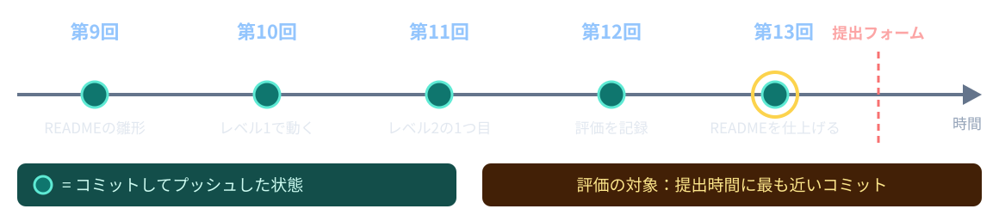
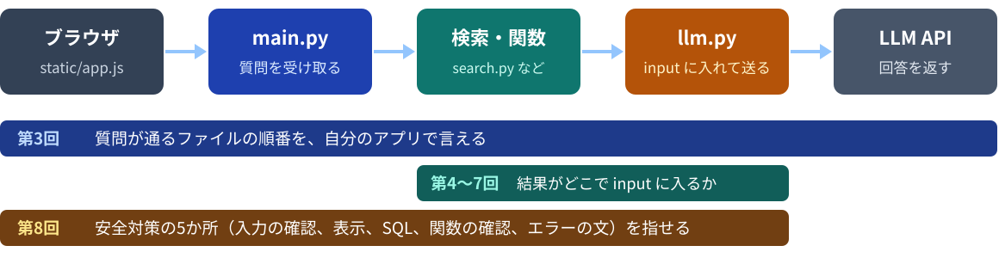
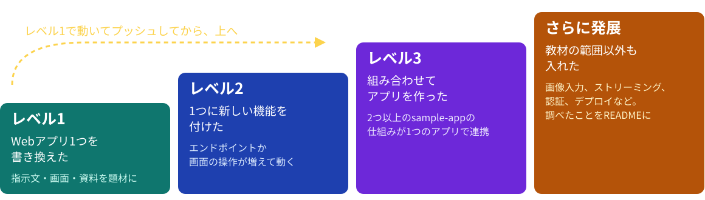
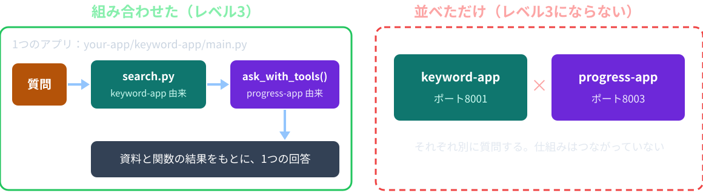
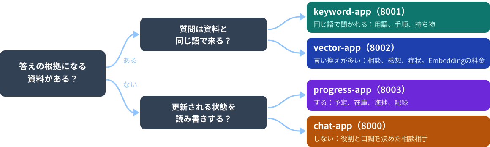
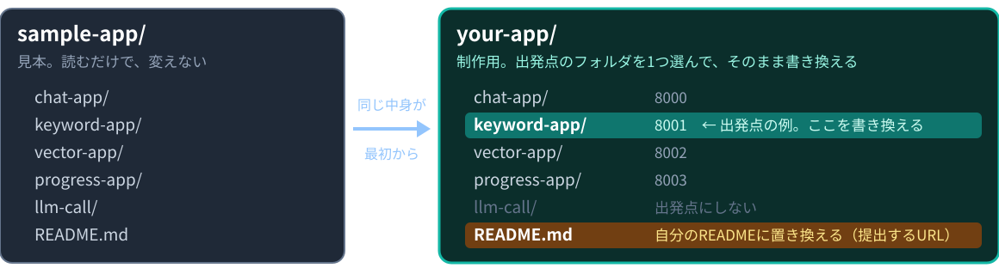

# 第9回：制作（1）

制作の進め方を知り、自分のアプリを動かし始める

---

## 授業の前に：forkを最新にする

配布リポジトリが更新されていてもよいように、毎回最初に自分のforkを最新にします。

```bash
git remote add upstream https://github.com/kappaexpress/llm-app-intro-class-2026   # 初回のみ
git fetch upstream
git merge upstream/main
```

GitHubの自分のforkにある **Sync fork** ボタンでもかまいません。
続けて `source .venv/bin/activate` を実行します。
APIキーは、サーバーを起動するターミナルで `export OPENAI_API_KEY=sk-********` を実行します。

---

## 今日のゴール

1. 制作の目標「小さくても全部自分で説明できるLLMアプリ」と、評価の原則を言える
2. 評価レベル1〜3とさらに発展を、sample-appのどのファイルを変えると何になるかで説明でき、自分の企画のレベルを判定できる
3. 出発点にするsample-appを、題材の性質から選べる
4. READMEに書く項目を知り、雛形から書き始められる
5. `your-app/` の出発点のフォルダを起動し、テーマと狙うレベルを `design.md` に確定して、第10回に何を動かすかを決めた状態で今日を終える

---

## 今日の進め方

| 時間 | すること |
|---|---|
| 5限 | 制作の解説：目的と評価 → 評価レベル → 出発点の選び方 → README → 進め方。途中で `design.md` に3分ずつ書く |
| 休憩 | 5限と6限のあいだに取る |
| 6限 | 制作開始：作業1 出発点を起動 → 作業2 `design.md` を確定 → 作業3 レベル1の1つ目の変更 |
| 最後 | 今日のポイント、プッシュ、提出 |

今日の提出物は `your-app/README.md`（雛形でよい）と、仕上げた `session08/exercise/design.md` です。
制作中も、質問するたびにAPI利用料金が発生します。画面の入力トークン数を見る癖を付けます。

---

## 制作の目標

**小さくても全部自分で説明できるLLMアプリ**を、自分の手で完成させます。

| 見ること | 見ないこと |
|---|---|
| 動くこと | 画面の派手さ |
| どのファイルの何行が、何をしているかを言えること | 機能の数 |
| 変えた場所と理由が、READMEに書いてあること | アイディアの良し悪し |

出発点は、授業で読んできた `sample-app/` のWebアプリ4つのどれかです。

---

## 第9〜13回の日程

| 回 | 授業でやること | 終了前の10分 |
|---|---|---|
| 第9回（今日） | 5限：制作の解説。6限：制作開始、テーマ決め | プッシュ、URLを提出 |
| 第10〜12回 | 制作（作業と質問対応） | プッシュ、URLを提出 |
| 第13回 | 制作、最終提出 | プッシュ、URLを提出 |

毎回、出席フォームに同じURLを出します。

```text
https://github.com/<自分のユーザー名>/llm-app-intro-class-2026/blob/main/your-app/README.md
```

---

## 評価の原則

- 評価は**制作物だけ**で行う。第1〜8回の `exercise` は評価に含めない
- アイディアは評価しない。**技術的な面**から評価する
- 動かないものより、**小さくても動くもの**を高く評価する
- **レベル1を完成させてから**、上を目指す
- 評価の対象は、**最終課題提出フォームの提出時間に最も近いコミット**

---

## 評価の対象になるコミット



プッシュしていないコミットは、GitHubにはありません。
毎回プッシュしておけば、途中の状態が評価されることはあっても、「何も無い」にはなりません。

---

## 「説明できる」とは



生成AIに書かせたコードも、同じ基準で見ます。自分の言葉で説明できる状態にします。

---

## 評価レベル



対象は `chat-app`・`keyword-app`・`vector-app`・`progress-app` の4つ。
`llm-call/` はターミナルだけで動くので、Webアプリとみなさず、出発点にしません。

---

## 判定の原則

| 言葉 | 判定の原則 |
|---|---|
| 書き換えた | 見た目・文言を書き換えた状態にある |
| 新しい機能 | エンドポイントまたは画面の操作が1つ以上増え、動く |
| 組み合わせた | 2つ以上のsample-appに由来する仕組みが、1つのアプリの中で連携して動く。並べて置いただけは含めない |
| さらに発展 | 教材で扱わなかった技術・工夫が動いていて、READMEに何を調べて入れたかが書いてある |

上のレベルを狙って動かないものより、下のレベルで動くものを高く評価します。

---

## どこを変えると何レベルか：レベル1

<style scoped>table { font-size: 20px; }</style>

| 出発点 | 例 | 変えるファイル |
|---|---|---|
| chat-app | 「〇〇相談チャット」に | `main.py` 29行の `INSTRUCTIONS`（chat-appだけ `main.py` にある）、`static/index.html` の見出しと説明文、`style.css` |
| keyword-app | 資料を自分の分野のものに入れ替える | `data/*.md` を入れ替えて `init_db.py`。`llm.py` の `INSTRUCTIONS` の「授業資料」も直す |
| vector-app | 同上 | 同上。`init_db.py` を実行するたびに、資料の分のEmbedding料金がかかる |
| progress-app | 「やること」を自分の題材の記録に | `llm.py` の `INSTRUCTIONS` と `TOOLS` の説明、`progress_db.py` の `FIRST_TASKS` |

どの出発点でも、指示文・画面の文言・資料（またはDBの中身）が自分の題材になっていれば、レベル1です。

---

## どこを変えると何レベルか：レベル2

<style scoped>table { font-size: 21px; }</style>

| 例 | 増えるもの | 変えるファイル |
|---|---|---|
| chat-appに会話の保存・読み込み | 保存と読み込みのエンドポイント、ボタン | `main.py` にエンドポイント、`static/app.js` にボタン、保存先（SQLite） |
| keyword-appに登録した資料の一覧画面 | `/api/sources`、一覧の表示 | `main.py` に `/api/sources`、`index.html` と `app.js` に表示 |
| progress-appに文言の変更・削除の関数 | LLMが選べる関数 | `llm.py` の `TOOLS` と `run_tool()`、`progress_db.py` に関数（検証も書く） |

「新しい機能」は、エンドポイントか画面の操作が1つ以上増えて、動くことです。
関数を足すときも、第7回の「権限をコードで制限する」（決まったSQL、`?`、`check_keys()`）は崩しません。

---

## どこを変えると何レベルか：レベル3と発展

| レベル | 例 | 変えるファイル |
|---|---|---|
| 3 | 資料検索 + Function Calling | keyword-appの `search.py` と、progress-appの `ask_with_tools()` を、1つの `main.py` から使う |
| 3 | 履歴を持ちながらRAG | chat-appの `history` に、keyword-appの `build_context()` の結果を足す |
| 発展 | 画像入力、ストリーミング表示、別のLLMサービスの併用、認証、外部APIの呼び出し、デプロイ | READMEに、何を調べて、どこに入れたかを書く |

レベル3も発展も、まずレベル1の状態で動いてからです。

---

## 「組み合わせた」と「並べただけ」



1つの質問の処理の中で、2つのsample-appに由来する仕組みがつながって動くことが条件です。

---

## 上を狙う前に、レベル1をプッシュする

1. 出発点のフォルダを書き換えて、レベル1の状態で動かす
2. 動いたら、コミットしてプッシュする（ここで評価の土台ができる）
3. レベル2・3の変更を1つずつ足す。動いたら、またプッシュする
4. 動かなくなったら、直前のコミットに戻してやり直す

レベル2・3を狙う人も、最初の1回は「書き換えて動く」状態でプッシュします。

---

## 作業：自分の企画のレベルを書く（3分）

`session08/exercise/design.md` を開き、3「出発点にする sample-app のフォルダと理由」の欄に、狙うレベルを書きます。

```text
狙うレベル：レベル1（まず資料と画面の文言を書き換える）。出発点：未定
```

- `design.md` には「狙うレベル」の欄が無いので、3の欄に書きます
- 決まっていなければ「未定」と、その理由を書きます
- 迷ったら、まずレベル1と書きます

---

## 出発点の選び方



アプリの見た目ではなく、題材の性質で選びます。

---

## テーマ例（説明用・架空）

| テーマ | 出発点 | 理由 |
|---|---|---|
| 部活の新入部員向け案内 | keyword-app | 持ち物や活動場所は、案内と同じ語で聞かれる |
| 学科の履修相談 | vector-app | 「単位が足りるか」など、言い方が揺れる |
| アルバイトのシフト・備品の記録 | progress-app | 予定や備品を追加し、完了にする |
| レポートの構成相談チャット | chat-app | 資料は使わず、指示文で役割を決める |

テーマの良し悪しは評価しません。資料が手に入り、自分で説明できる題材を選びます。

---

## 資料の注意

- 自分で入手でき、使ってよいものを使う。入手方法と利用許可をREADMEに書く
- 実在の人の成績・連絡先などは入れない。必要なら**架空のデータ**を作る（sample-appの進捗データも架空）
- keyword-appとvector-appの資料は、Marp形式の `data/*.md`
- 1枚の本文は1000文字以内（`init_db.py` の `MAX_BODY_LENGTH`）
- 資料を変えたら、サーバーを止めて `python init_db.py` → `python main.py`

---

## 資料はMarp形式に直す

```markdown
---
marp: true
---

# ソフトテニス部 新入部員案内

---

## 練習日と持ち物

水曜は試合形式の練習です。ラケットを持ってきます。
```

- `---` だけの行でスライドを区切る。各スライドの最初の `#`・`##` が見出し
- PDFやWebページの資料は、区切りと見出しを付けてMarkdownに直す
- 形式は `init_db.py` の先頭の説明（17〜31行）に書いてある

---

## 作らない機能を先に決める

| 最小版で作る | 作らない |
|---|---|
| 質問、回答、LLMに渡した資料の表示 | 会話履歴、ログイン、公開 |
| 根拠が足りないときの決まった文 | 予定の書き込み（keyword-appの場合） |

- 作らないと決めたことは、READMEの「評価と限界」に書く
- 教材のアプリには認証も利用量の管理も無いので、公開は前提にしない（第8回「教材と本番運用の違い」）

---

## 作業：出発点を決める（3分）

`design.md` の3の欄に、出発点のフォルダと理由を書きます。

```text
出発点：your-app/keyword-app（持ち物や場所は、案内と同じ語で聞かれるため）
```

- フォルダは `sample-app/` ではなく `your-app/` のほうで書きます
- 理由は、題材の性質（資料があるか、同じ語で聞かれるか、言い換えが多いか、更新される状態か）で書きます
- 2つで迷ったら、資料が手に入るほうにします

---

## READMEに書く項目

| 項目 | 書くこと | |
|---|---|---|
| このアプリは何か | 対象者と困りごと | 必須 |
| 使い方 | 質問の例と、どんな答えが返るか | 必須 |
| 起動手順 | `export` → `cd` →（`init_db.py` →）`main.py` → ポート | 必須 |
| 出発点にしたsample-app | フォルダ名 | 必須 |
| 狙ったレベル | レベル1〜3、さらに発展 | 必須 |
| 変えた場所 | ファイル名・関数名、変えたこと、理由 | 説明の材料 |
| 評価と限界 | 評価用質問10問の結果、できないこと | 説明の材料 |

提出するのは `your-app/README.md` です。最初は `sample-app/README.md` のコピーなので、中身を雛形に置き換えます。

---

## READMEの雛形（前半）

<style scoped>pre { font-size: 18px; }</style>

```markdown
# アプリ名

## このアプリは何か
対象者と困りごとを1〜3文で書く。

## 使い方
質問の例を3つと、どんな答えが返るかを書く。

## 起動手順
1. ターミナルで `export OPENAI_API_KEY=sk-********`（キーはファイルに書かない）
2. `cd your-app/keyword-app`
3. `python init_db.py`（keyword-app・vector-appのとき。資料を変えたら毎回）
4. `python main.py` を実行し、「ポート」タブから8001番を開く

## 出発点にした sample-app と狙ったレベル
keyword-app（`your-app/keyword-app/` を書き換えた）。レベル1（→ 2を目指す）
```

---

## READMEの雛形（後半）

<style scoped>pre { font-size: 19px; }</style>

```markdown
## 変えた場所
| ファイル | 変えたこと | 理由 |
|---|---|---|

## 評価と限界
評価用質問10問の結果（第8回の evaluation.md と同じ形）。
できないこと、公開しない理由。

## 資料の出典（keyword-app・vector-appの場合）
入手方法と利用許可。

## 調べて入れたこと（さらに発展の場合）
何を調べ、どこに入れたか。
```

このスライドは配布リポジトリの `session09/slides09.md` にもあります。コピーして使えます。

---

## 「変えた場所」の書き方

ファイル名と関数名（または行）で書きます。

| ファイル | 変えたこと | 理由 |
|---|---|---|
| `llm.py` の `INSTRUCTIONS` | 「授業資料」を「部活の案内」に。根拠が足りないときの文も題材に | 資料を部活の案内に入れ替えたため |
| `static/index.html` 14・15行 | 見出しと説明文 | 題材に合わせるため。17行の送信の注意書きは残した |

元のsample-appとの違いは、`git diff` に `--no-index` を付けると見られます。

```bash
git --no-pager diff --no-index sample-app/keyword-app/llm.py your-app/keyword-app/llm.py
```

---

## 「評価と限界」の書き方

第8回の `evaluation.md` と同じ形を、自分の題材で使います。

| 書くこと | 内容 |
|---|---|
| 評価用質問10問 | 5種類（直接答えがある・言い換え・複数のページが必要・資料にない・ハルシネーションを誘う） |
| 検索の結果 | 期待する根拠が渡されたか：全部・一部・なし |
| 回答の点数 | 正確さ・根拠・対応を、それぞれ0〜2点。入力トークン数も |
| 不正な指示 | 資料に命令を混ぜて試した結果 |
| 限界 | できないこと、作らない機能、公開しない理由 |

限界を自分で説明できることも、説明の材料になります。

---

## 安全対策の5か所を自己点検する

<style scoped>table { font-size: 21px; }</style>

| 対策 | 場所（keyword-appの場合） |
|---|---|
| 回答をHTMLとして実行しない | `static/app.js` 68行の `textContent` |
| 質問の型と長さ | `main.py` 67〜69行の `Field(min_length=1, max_length=500)` |
| SQLに値を直接つなげない | progress-appの `progress_db.py` の `?` |
| 許可した関数だけ実行 | progress-appの `llm.py` の `run_tool()` と `check_keys()` |
| APIエラーは決まった文 | `main.py` 103〜105行の `except APIError` |

第8回の点検表です。改造した後もこの5か所が残っているかを、READMEに書きます。

---

## your-app/ の使い方



- 出発点のフォルダをそのまま書き換えます。コピーは要りません。使わないフォルダは残しておいてかまいません
- ポートは元のまま（8000〜8003）。sample-appと同時に動かすときは、どちらかを止めるか、`main.py` 末尾の `port=` を変えます

---

## 小さく動かす順（目安）

| 回 | 目安 |
|---|---|
| 第9回 | 出発点を起動する。テーマを確定し、READMEを雛形に置き換える |
| 第10回 | レベル1の状態で動く（指示文・画面・資料） |
| 第11回 | 根拠表示・回答保留・エラー表示を自分の題材で確かめる。レベル2の1つ目 |
| 第12回 | 評価用質問10問で評価し、1か所変えて前後を記録する |
| 第13回 | READMEを仕上げ、最終提出 |

評価の条件ではなく、目安です。`design.md` の8の表に、自分の目標を書きます。

---

## 毎回プッシュする

- 動く状態でコミットしてから、次の変更に入る
- 評価の対象は、最終課題提出フォームの提出時間に最も近いコミット

動かなくなったら、直前のコミットとの違いを見て、戻します。

```bash
git diff                                  # 直前のコミットとの違いを見る
git restore your-app/keyword-app/llm.py   # このファイルを直前のコミットの状態に戻す
```

`your-app/` は最初からGitで追跡されているので、初めから元に戻せます。
`git restore` は書きかけの変更を消すので、`git diff` で確かめてから使います。

---

## 生成AIの使い方

- 使ってかまいません。積極的に使ってください
- 貼り付ける前に、「どのファイルの、何を変える提案か」を読む
- 貼り付けた後に、READMEの「変えた場所」に自分の言葉で書けるものだけを採用する
- `sample-app/README.md`「書き方の方針」から外れた提案は、説明できる形に直す

| 書き方の方針 |
|---|
| Pydanticの入力モデルを除き、独自クラスや継承は使わない |
| 内包表記や複雑なコールバックを避け、for・if・辞書・普通の関数で書く |
| 1つのファイルに1つの役割。関数の先頭に何をするかを書く |

APIキーや個人情報は、生成AIにも貼り付けません。

---

## 相談のしかた

| 伝えること | 例 |
|---|---|
| 送った質問の文 | 「水曜の練習の持ち物は？」 |
| 画面のステータス | 「API呼び出しに失敗しました。…」 |
| ターミナルのエラーの最後の数行 | `ValueError: club.md の3枚目が長すぎます。…` |
| 変えたファイル名 | `llm.py` の `INSTRUCTIONS` |

この4つがあると、どこで止まっているかを一緒に切り分けられます。
APIキーは共有しません。チャットにも貼りません。

---

## 今日のポイント

- 評価は制作物の技術的な面だけで決まる。アイディアの良し悪しは評価せず、動かない大きなものより、小さくても動くものを高く評価する
- まずレベル1（sample-appのWebアプリ1つを書き換えて動く状態）をプッシュしてから、レベル2・3を目指す
- READMEは今日から書く。出発点、狙うレベル、変えた場所を、ファイル名と関数名で書く
- 毎回プッシュする。評価の対象は、最終課題提出フォームの提出時間に最も近いコミット

---

# 休憩

**6限は 18:20 から始めます。**

後半は、`your-app/` の出発点のフォルダを起動して、制作を始めます。

---

## 作業1：出発点を起動する（15分）

```bash
cd your-app/keyword-app   # 自分の出発点のフォルダ
python init_db.py         # keyword-app・vector-appのとき
python main.py
```

1. 「ポート」タブから開き、1問送って、sample-appと同じ動きをすることを確かめる
2. `your-app/README.md` の中身を雛形（25・26枚目）に置き換え、アプリ名・出発点・狙うレベルだけ書く

- chat-appとprogress-appは `init_db.py` がありません。`python main.py` だけです
- vector-appの `init_db.py` はAPIキーが要り、Embeddingの料金がかかります

---

## 作業2：design.md を確定する（20分）

`session08/exercise/design.md` の「未定」を埋めます。

| 欄 | 書くこと |
|---|---|
| 1・2 | 対象者と困りごと、資料（入手方法と利用許可） |
| 3・4 | 出発点、狙うレベル、検索方式と理由 |
| 5 | 根拠が足りないときの応答 |
| 6 | 評価用質問10問（5種類） |
| 7・8 | 作る機能と作らない機能、第9〜13回の目標 |

決まらない人は、選択肢を2つに絞り、資料が手に入るほうにします。チャットで講師に相談してください。

---

## 作業2：資料を入れる（keyword-app・vector-app）

1. 自分の資料をMarp形式にして、`your-app/<出発点>/data/` に入れる
2. 元の `data/session01.md` は消してよい（`sample-app/` に残っている）
3. サーバーをCtrl+Cで止めて、DBを作り直し、起動し直す

```bash
python init_db.py
python main.py
```

4. 評価用質問を1問送り、「LLMに渡した資料」に自分の資料が出るかを見る

---

## 作業3：レベル1の1つ目の変更（38分）

| 変えるもの | 場所 |
|---|---|
| 指示文 `INSTRUCTIONS` | chat-appは `main.py` 29行、ほかの3つは `llm.py` |
| 「授業資料」「やること」などの語、根拠が足りないときの文 | `INSTRUCTIONS` の中 |
| 見出しと説明文 | `static/index.html` 14・15行（タブの名前は6行） |
| 送信の注意書き | `static/index.html` 17行。題材に合わせてよいが、消さない |

1. サーバーを止めて起動し直し、1問送る
2. READMEの「変えた場所」に1行書き、ここで1回コミットする
3. 余裕があれば、評価用質問10問のうち3問を送り、第8回の形で記録を始める

---

## 巡回で見るチェックリスト

| | 確かめること |
|---|---|
| 1 | テーマと出発点が `design.md` に書いてある |
| 2 | `your-app/` の出発点のフォルダが起動して、1問答える |
| 3 | `your-app/README.md` に、出発点と狙うレベルが書いてある |
| 4 | APIキーをファイルに書いていない |

講師が回ってきたら、この4つを画面で見せてください。
終わっていない項目があれば、今日はそこまでを目標にします。

---

## 失敗した場所の切り分け

<style scoped>table { font-size: 21px; }</style>

| 観察した状態 | まず確認すること |
|---|---|
| 起動できない | `cd your-app/<出発点>` で、そのフォルダから起動したか。keyword・vectorは `init_db.py` から |
| 「address already in use」 | 同じ番号のsample-appが動いていないか。止めるか `main.py` 末尾の `port=` を変える |
| 資料を入れたのに見つからない | Marp形式（`---` 区切り、見出し）か。`init_db.py` → 再起動したか |
| `init_db.py` が「長すぎます」で止まる | 1枚を1000文字以内に分ける |
| 指示文を変えても回答が変わらない | サーバーを再起動したか（`INSTRUCTIONS` は起動時に読まれる） |
| `FIRST_TASKS` を変えても進捗が変わらない | 止めて `progress.db` を消してから起動したか |
| 「API呼び出しに失敗しました」 | 同じターミナルで `export` したか |

---

## 提出物と次回

`your-app/` と `design.md` をコミットし、プッシュします。

```bash
cd ../..   # リポジトリのルートへ戻る（your-app/<出発点> から）
git status
git add your-app session08/exercise/design.md
git commit -m "第9回: 制作開始"
git push
```

GitHubで `your-app/README.md` を開き、そのURLをTeamsの出席フォームから提出します。第10回以降も同じURLです。授業の終わりの時点で未完成でも提出します。
`documents.db`・`progress.db` は `.gitignore` によりコミットされません。終了時はサーバーを止めて `unset OPENAI_API_KEY`。
次回は、レベル1の状態で動くことが目標です。
